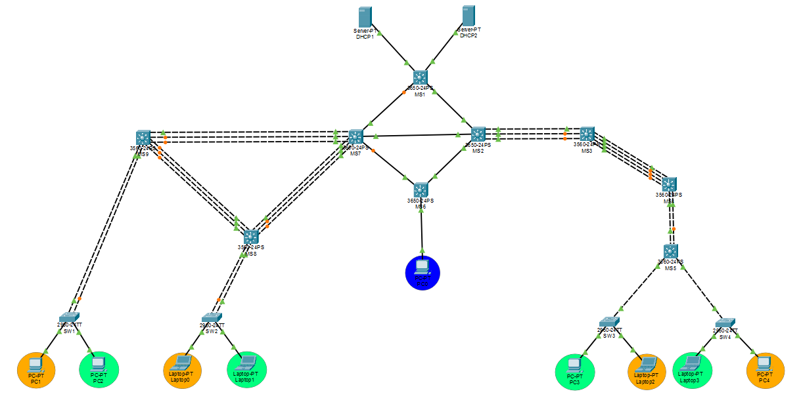
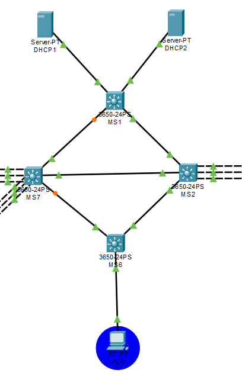
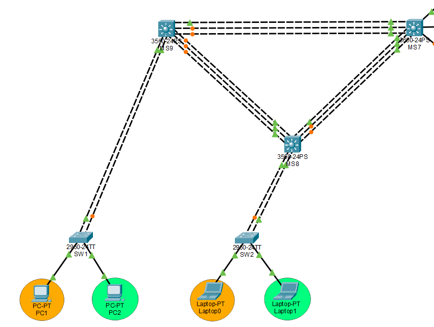
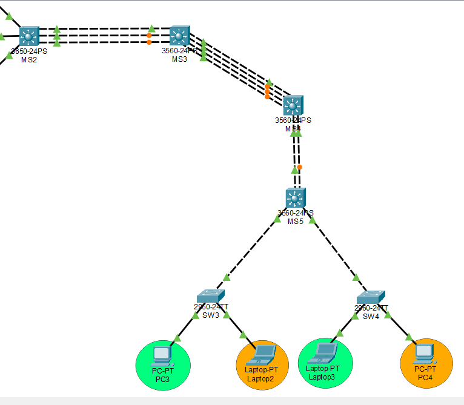

# **_Proyecto 1_**

## Chapin Red

### 2do Semestre del 2026

```js
Universidad San Carlos de Guatemala
Programador: César Rolando Hernández Palacios
Carne: 202000806
Correo: cesarhernandez0019@gmail.com
```

---


## Manual Tecnico


### 1.  **Implementacion de topologia**

#### 1.1 **Topologia completa**



#### 1.2 **Conexión entre Edificios (Red MAN - Metropolitan Area Network)**



#### 1.3 **Red del Edificio Izquierdo**



#### 1.4 **Red del Edificio Derecho**




### 2.  **Esquemas de vlans**

| VLAN ID | Nombre de la VLAN                    | Ubicación / Propósito   | Uso                                            |
| ------: | ------------------------------------ | ----------------------- | ---------------------------------------------- |
|  **10** | `VLAN_Naranja_EdificioIZQ_202000806` | Edificio Izquierdo      | Segmento Naranja                               |
|  **20** | `VLAN_Verde_EdificioIZQ_202000806`   | Edificio Izquierdo      | Segmento Verde                                 |
|  **30** | `VLAN_Naranja_EdificioDER_202000806` | Edificio Derecho        | Segmento Naranja                               |
|  **40** | `VLAN_Verde_EdificioDER_202000806`   | Edificio Derecho        | Segmento Verde                                 |
|  **99** | `VLAN_ADMIN_EdificioADM_202000806`   | Edificio Administrativo | Administración y gestión de la infraestructura |


### Criterio de numeración
La numeración fue definida de manera que exista una separación entre los identificadores, permitiendo agregar nuevas VLAN posteriormente sin necesidad de modificar las VLAN existentes.

    VLAN 10: Naranja – Edificio Izquierdo.
    VLAN 20: Verde – Edificio Izquierdo.
    VLAN 30: Naranja – Edificio Derecho.
    VLAN 40: Verde – Edificio Derecho.
    VLAN 99: Administración.

La VLAN 99 se mantiene separada de las VLAN destinadas a los usuarios para facilitar la administración y gestión de los dispositivos de red.


### Configuración realizada en MS1
La creación de las VLAN se realizó en el switch multicapa MS1 mediante el siguiente procedimiento:

    enable
    configure terminal

    hostname MS1

    ! Creación de VLANs
    vlan 10
    name VLAN_Naranja_EdificioIZQ_202000806
    exit

    vlan 20
    name VLAN_Verde_EdificioIZQ_202000806
    exit

    vlan 30
    name VLAN_Naranja_EdificioDER_202000806
    exit

    vlan 40
    name VLAN_Verde_EdificioDER_202000806
    exit

    vlan 99
    name VLAN_ADMIN_EdificioADM_202000806
    exit

    end

---