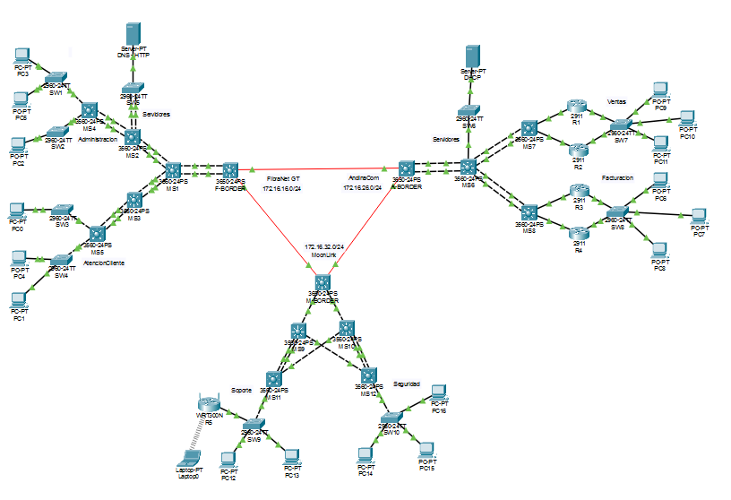
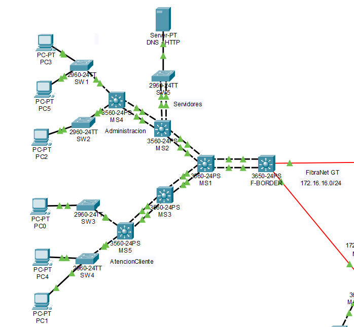
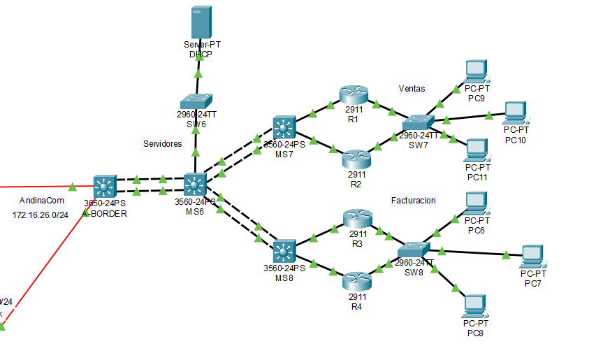
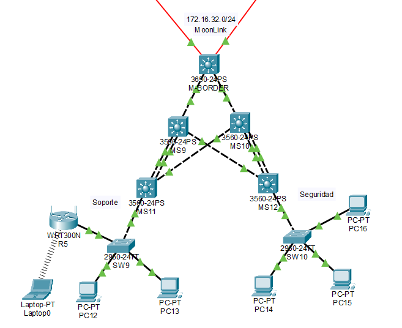
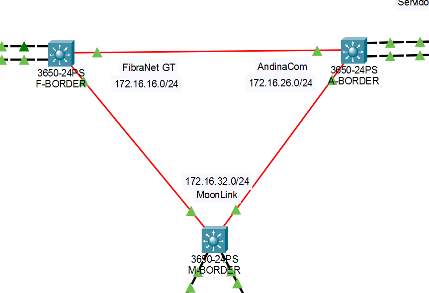

# **_Proyecto 2_**

## Proyecto Conectividad XXI: Integración de Operadores Nacionales

### 2do Semestre del 2026

```js
Universidad San Carlos de Guatemala
Programador: César Rolando Hernández Palacios
Carne: 202000806
Correo: cesarhernandez0019@gmail.com
```

---

## Manual Técnico

### 1. **Datos generales**

#### 1.1 **Redes asignadas según el carné (202000806)**

| Uso               | Regla del enunciado                         | Red resultante                  |
| ----------------- | ------------------------------------------- | ------------------------------- |
| Interconexión BGP | `192.168.XX.0/16` (XX = últimos 2 dígitos)  | 192.168.6.0 (subneteada en /30) |
| FibraNet GT       | `172.16.1X.0/24` (X = último dígito: 6)     | **172.16.16.0/24**              |
| AndinaCom         | `172.16.2X.0/24` (X = último dígito: 6)     | **172.16.26.0/24**              |
| MoonLink          | `172.16.3X.0/24` (X = **primer** dígito: 2) | **172.16.32.0/24**              |

---

### 2. **Topología completa**



| ISP         | Topología            | Protocolo interno | Departamentos                       | Servicios / extras |
| ----------- | -------------------- | ----------------- | ----------------------------------- | ------------------ |
| FibraNet GT | Árbol                | OSPF              | Administración, Atención al cliente | DNS y HTTP/HTTPS   |
| AndinaCom   | Jerárquica (3 capas) | OSPF              | Ventas, Facturación                 | DHCP, HSRP         |
| MoonLink    | Hub-and-spoke        | EIGRP             | Soporte, Seguridad                  | Red inalámbrica    |

Los tres ISPs se interconectan mediante BGP entre sus switches multicapa de borde.

---

### 3. **ISP 1: FibraNet GT**

#### 3.1 **Requisitos**

- Topología en árbol.
- Protocolo de enrutamiento interno: OSPF (área 0).
- Mínimo 5 routers, 5 hosts y 2 enlaces LACP.
- Dos departamentos (Administración y Atención al cliente), con subredes para hasta 75 hosts.
- Provee el servicio DNS y HTTP/HTTPS a toda la topología.

#### 3.2 **Topología**

La raíz del árbol es el switch multicapa MS1 (3560-24PS), que actúa como core de la red. De MS1 cuelgan tres ramas: la frontera hacia los otros ISP (F-BORDER), la rama de MS2 y la rama de MS3. Cada nodo tiene un único padre, lo que mantiene la topología en árbol.

- **Frontera BGP:** MS1 → F-BORDER → enlace hacia los otros ISP.
- **Rama de servicios y Administración:** MS1 → MS2, de donde salen dos ramas:
  - MS2 → SW5 → Server0 (DNS y HTTP/HTTPS).
  - MS2 → MS4 → SW1 y SW2 → PC3, PC5 y PC2 (Administración).
- **Rama de Atención al cliente:** MS1 → MS3 → MS5 → SW3 y SW4 → PC0, PC4 y PC1.



| Dispositivo                   | Modelo    | Función                                                                                          |
| ----------------------------- | --------- | ------------------------------------------------------------------------------------------------ |
| MS1                           | 3560-24PS | Core y raíz del árbol, une todas las ramas                                                       |
| F-BORDER (Multilayer Switch0) | 3650-24PS | Frontera de la red, único equipo que habla BGP con los otros ISP                                 |
| MS2                           | 3560-24PS | Distribución de Administración y del segmento de servidores; gateway de servidores (SVI VLAN 10) |
| MS3                           | 3560-24PS | Distribución de la rama de Atención al cliente                                                   |
| MS4                           | 3560-24PS | Gateway de Administración (SVI VLAN 20)                                                          |
| MS5                           | 3560-24PS | Gateway de Atención al cliente (SVI VLAN 30)                                                     |
| SW1 / SW2                     | 2960-24TT | Acceso Administración                                                                            |
| SW3 / SW4                     | 2960-24TT | Acceso Atención al cliente                                                                       |
| SW5                           | 2960-24TT | Acceso del segmento de servidores (VLAN 10)                                                      |
| Server0                       | Server-PT | DNS y HTTP/HTTPS                                                                                 |

Total: 6 switches multicapa que cumplen el rol de routers (MS1 a MS5 y F-BORDER), 6 hosts (PC0 a PC5) más el servidor, y 6 enlaces EtherChannel LACP.

#### 3.3 **Subneteo de departamentos (172.16.16.0/24)**

Se requieren subredes para hasta 75 hosts. Se necesitan 7 bits de host (2⁷ − 2 = 126 útiles), por lo que corresponde una máscara /25.

| Departamento        | VLAN | Red              | Máscara         | Rango útil  | Broadcast     | Gateway             |
| ------------------- | ---- | ---------------- | --------------- | ----------- | ------------- | ------------------- |
| Administración      | 20   | 172.16.16.0/25   | 255.255.255.128 | .1 – .126   | 172.16.16.127 | 172.16.16.1 (MS4)   |
| Atención al cliente | 30   | 172.16.16.128/25 | 255.255.255.128 | .129 – .254 | 172.16.16.255 | 172.16.16.129 (MS5) |

Los hosts de ambos departamentos obtienen su IP por DHCP. El servidor DHCP está en AndinaCom, por lo que MS4 y MS5 configuran `ip helper-address` en sus SVIs.

#### 3.4 **Tabla de direccionamiento de enlaces (10.1.0.0/24)**

Los dos /25 consumen todo el /24 asignado, por lo que no queda espacio para los enlaces punto a punto. Se utiliza una red privada adicional, 10.1.0.0/24, subneteada en /30 para los enlaces entre multicapa y en /29 para el segmento de servidores.

| Enlace                 | Red          | Extremo A                       | Extremo B               |
| ---------------------- | ------------ | ------------------------------- | ----------------------- |
| MS1 ↔ F-BORDER         | 10.1.0.0/30  | .1 (MS1)                        | .2 (F-BORDER)           |
| MS1 ↔ MS2              | 10.1.0.4/30  | .5 (MS1)                        | .6 (MS2)                |
| MS1 ↔ MS3              | 10.1.0.8/30  | .9 (MS1)                        | .10 (MS3)               |
| MS2 ↔ MS4              | 10.1.0.12/30 | .13 (MS2)                       | .14 (MS4)               |
| MS3 ↔ MS5              | 10.1.0.16/30 | .17 (MS3)                       | .18 (MS5)               |
| Segmento de servidores | 10.1.0.24/29 | .25 (MS2, gateway, SVI VLAN 10) | .26 (Server0, estática) |

El servidor usa IP estática, ya que el requisito de DHCP aplica a los dispositivos finales (hosts).

#### 3.5 **Enlaces LACP (EtherChannel)**

Todos los enlaces entre equipos de distribución se implementan como pares de cables agrupados con LACP (`channel-group X mode active`), lo que da más ancho de banda y tolerancia a la falla de un cable.

| Port-channel | Enlace         | Puertos A (equipo) | Puertos B (equipo)   | Tipo                                      |
| ------------ | -------------- | ------------------ | -------------------- | ----------------------------------------- |
| Po1          | MS1 ↔ F-BORDER | Fa0/1-2 (MS1)      | Gi1/0/1-2 (F-BORDER) | Capa 3 (puerto enrutado, `no switchport`) |
| Po2          | MS1 ↔ MS2      | Fa0/3-4 (MS1)      | Fa0/1-2 (MS2)        | Capa 3                                    |
| Po3          | MS1 ↔ MS3      | Fa0/5-6 (MS1)      | Fa0/1-2 (MS3)        | Capa 3                                    |
| Po4          | MS2 ↔ MS4      | Fa0/3-4 (MS2)      | Fa0/1-2 (MS4)        | Capa 3                                    |
| Po5          | MS3 ↔ MS5      | Fa0/3-4 (MS3)      | Fa0/1-2 (MS5)        | Capa 3                                    |
| Po6          | MS2 ↔ SW5      | Fa0/5-6 (MS2)      | Fa0/2-3 (SW5)        | Capa 2 (acceso a VLAN 10)                 |

Se verifican con `show etherchannel summary`, donde cada Port-channel debe aparecer en estado `SU` y sus puertos en estado `P`.

#### 3.6 **OSPF (área 0)**

Todas las interfaces de capa 3 (Port-channels enrutados y SVIs) pertenecen al área 0. Las SVIs de usuarios (VLAN 20 y VLAN 30) se declaran como `passive-interface` para no enviar hellos hacia los hosts. F-BORDER es el equipo que conecta FibraNet GT con el resto de ISPs: anuncia por BGP las redes 172.16.16.0/24 y 10.1.0.0/24, y entrega al interior de OSPF las rutas aprendidas de los otros ISP.

#### 3.7 **Justificación de decisiones de diseño**

- **Árbol:** cada nodo tiene un solo padre. Los EtherChannel entre pares de equipos cuentan como un único enlace lógico y no rompen la topología.
- **MS1 como core:** concentra las tres ramas, por lo que todo el tráfico entre departamentos y hacia el exterior pasa por un solo punto, donde se aplican las ACLs y se controla el tráfico.
- **F-BORDER separado del core:** aísla BGP y la conexión con los otros ISP del resto de la red interna. Un problema en la frontera no afecta el enrutamiento interno y se puede reemplazar sin tocar el core.
- **Multicapa como routers:** los switches 3560/3650 enrutan en hardware y soportan OSPF, SVIs y Port-channels de capa 3, lo que reduce costos frente a tener routers y switches separados.
- **LACP en la distribución:** protege los enlaces críticos del árbol. La caída de un cable no interrumpe el servicio.
- **Switch 2960-24TT en acceso:** es el switch administrable más económico y suficiente para conectar usuarios y servidor.
- **Gateways en MS4 y MS5:** cada departamento tiene su gateway en la hoja de su rama, por lo que el tráfico entre departamentos sube hasta el core.
- **Segmento de servidores en VLAN 10:** permite agregar más servidores sin modificar el direccionamiento (la subred 10.1.0.24/29 tiene 4 direcciones libres además del gateway y Server0).
- **Un departamento por rama:** simplifica la aplicación de las ACLs.
- **Mejora en producción:** MS1 y F-BORDER son puntos únicos de falla. En un entorno real se duplicarían.

#### 3.8 **Configuración por dispositivo**

Resumen de VLANs utilizadas:

| VLAN | Nombre           | Dónde se crea | Uso                                   |
| ---- | ---------------- | ------------- | ------------------------------------- |
| 10   | SERVIDORES       | MS2, SW5      | Segmento de servidores (10.1.0.24/29) |
| 20   | ADMINISTRACION   | MS4, SW1, SW2 | Hosts de Administración               |
| 30   | ATENCION_CLIENTE | MS5, SW3, SW4 | Hosts de Atención al cliente          |

##### 3.8.1 **F-BORDER (3650)**

```
enable
configure terminal
hostname F-BORDER

! Habilitar enrutamiento en el switch multicapa
ip routing

! Po1 hacia MS1 (capa 3)
interface range gi1/0/1 - 2
 no switchport
 channel-group 1 mode active
 no shutdown
interface port-channel 1
 ip address 10.1.0.2 255.255.255.252
 no shutdown
end
write memory
```

##### 3.8.2 **MS1 (core)**

```
enable
configure terminal
hostname MS1

ip routing

! Po1 hacia F-BORDER
interface range fa0/1 - 2
 no switchport
 channel-group 1 mode active
 no shutdown
interface port-channel 1
 ip address 10.1.0.1 255.255.255.252
 no shutdown

! Po2 hacia MS2
interface range fa0/3 - 4
 no switchport
 channel-group 2 mode active
 no shutdown
interface port-channel 2
 ip address 10.1.0.5 255.255.255.252
 no shutdown

! Po3 hacia MS3
interface range fa0/5 - 6
 no switchport
 channel-group 3 mode active
 no shutdown
interface port-channel 3
 ip address 10.1.0.9 255.255.255.252
 no shutdown
end
write memory
```

##### 3.8.3 **MS2 (distribución de Administración y servidores)**

```
enable
configure terminal
hostname MS2

ip routing

! VLAN y SVI del segmento de servidores (gateway de Server0)
vlan 10
 name SERVIDORES
interface vlan 10
 ip address 10.1.0.25 255.255.255.248
 no shutdown
exit

! Po2 hacia MS1
interface range fa0/1 - 2
 no switchport
 channel-group 2 mode active
 no shutdown
interface port-channel 2
 ip address 10.1.0.6 255.255.255.252
 no shutdown

! Po4 hacia MS4
interface range fa0/3 - 4
 no switchport
 channel-group 4 mode active
 no shutdown
interface port-channel 4
 ip address 10.1.0.13 255.255.255.252
 no shutdown

! Po6 hacia SW5 (capa 2, acceso a VLAN 10)
interface range fa0/5 - 6
 switchport mode access
 switchport access vlan 10
 channel-group 6 mode active
 no shutdown
interface port-channel 6
 switchport mode access
 switchport access vlan 10
end
write memory
```

##### 3.8.4 **MS3 (distribución de Atención al cliente)**

```
enable
configure terminal
hostname MS3

ip routing

! Po3 hacia MS1
interface range fa0/1 - 2
 no switchport
 channel-group 3 mode active
 no shutdown
interface port-channel 3
 ip address 10.1.0.10 255.255.255.252
 no shutdown

! Po5 hacia MS5
interface range fa0/3 - 4
 no switchport
 channel-group 5 mode active
 no shutdown
interface port-channel 5
 ip address 10.1.0.17 255.255.255.252
 no shutdown
end
write memory
```

##### 3.8.5 **MS4 (gateway de Administración)**

```
enable
configure terminal
hostname MS4

ip routing

! VLAN y SVI de Administración (gateway de la VLAN 20)
vlan 20
 name ADMINISTRACION
interface vlan 20
 ip address 172.16.16.1 255.255.255.128
 ip helper-address 172.16.26.130
 no shutdown
exit

! Po4 hacia MS2
interface range fa0/1 - 2
 no switchport
 channel-group 4 mode active
 no shutdown
interface port-channel 4
 ip address 10.1.0.14 255.255.255.252
 no shutdown
exit

! Troncales hacia SW1 (fa0/3) y SW2 (fa0/4)
interface range fa0/3 - 4
 switchport trunk encapsulation dot1q
 switchport mode trunk
 switchport trunk allowed vlan 20
end
write memory
```

##### 3.8.6 **MS5 (gateway de Atención al cliente)**

```
enable
configure terminal
hostname MS5

ip routing

! VLAN y SVI de Atención al cliente (gateway de la VLAN 30)
vlan 30
 name ATENCION_CLIENTE
interface vlan 30
 ip address 172.16.16.129 255.255.255.128
 ip helper-address 172.16.26.130
 no shutdown
exit

! Po5 hacia MS3
interface range fa0/1 - 2
 no switchport
 channel-group 5 mode active
 no shutdown
interface port-channel 5
 ip address 10.1.0.18 255.255.255.252
 no shutdown
exit

! Troncales hacia SW3 (fa0/3) y SW4 (fa0/4)
interface range fa0/3 - 4
 switchport trunk encapsulation dot1q
 switchport mode trunk
 switchport trunk allowed vlan 30
end
write memory
```

##### 3.8.7 **SW1 (acceso Administración)**

```
enable
configure terminal
hostname SW1

vlan 20
 name ADMINISTRACION

! Troncal hacia MS4
interface fa0/1
 switchport mode trunk
 switchport trunk allowed vlan 20
exit

! Puertos de hosts
interface range fa0/2 - 3
 switchport mode access
 switchport access vlan 20
 no shutdown
exit
end
write memory
```

##### 3.8.8 **SW2 (acceso Administración)**

```
enable
configure terminal
hostname SW2

vlan 20
 name ADMINISTRACION

! Troncal hacia MS4
interface fa0/1
 switchport mode trunk
 switchport trunk allowed vlan 20
exit

! Puerto de host
interface fa0/2
 switchport mode access
 switchport access vlan 20
 no shutdown
exit
end
write memory
```

##### 3.8.9 **SW3 (acceso Atención al cliente)**

```
enable
configure terminal
hostname SW3

vlan 30
 name ATENCION_CLIENTE

! Troncal hacia MS5
interface fa0/1
 switchport mode trunk
 switchport trunk allowed vlan 30
exit

! Puerto de host
interface fa0/2
 switchport mode access
 switchport access vlan 30
 no shutdown
exit
end
write memory
```

##### 3.8.10 **SW4 (acceso Atención al cliente)**

```
enable
configure terminal
hostname SW4

vlan 30
 name ATENCION_CLIENTE

! Troncal hacia MS5
interface fa0/1
 switchport mode trunk
 switchport trunk allowed vlan 30
exit

! Puertos de hosts
interface range fa0/2 - 3
 switchport mode access
 switchport access vlan 30
 no shutdown
exit
end
write memory
```

##### 3.8.11 **SW5 (acceso del segmento de servidores)**

```
enable
configure terminal
hostname SW5

vlan 10
 name SERVIDORES

! Puerto del servidor (Server0)
interface fa0/1
 switchport mode access
 switchport access vlan 10
 no shutdown
exit

! Po6 hacia MS2 (LACP)
interface range fa0/2 - 3
 switchport mode access
 switchport access vlan 10
 channel-group 6 mode active
 no shutdown
interface port-channel 6
 switchport mode access
 switchport access vlan 10
end
write memory
```

##### 3.8.12 **OSPF (proceso 1, área 0)**

OSPF se configura únicamente en los seis switches multicapa; los switches de acceso (SW1 a SW5) trabajan en capa 2 y no participan. Las redes se declaran con máscara wildcard: `0.0.0.3` para los /30, `0.0.0.7` para el /29 y `0.0.0.127` para los /25.

| Equipo   | Router-ID | Redes anunciadas                        | Interfaz pasiva |
| -------- | --------- | --------------------------------------- | --------------- |
| F-BORDER | 6.6.6.6   | 10.1.0.0/30                             | —               |
| MS1      | 1.1.1.1   | 10.1.0.0/30, 10.1.0.4/30, 10.1.0.8/30   | —               |
| MS2      | 2.2.2.2   | 10.1.0.4/30, 10.1.0.12/30, 10.1.0.24/29 | VLAN 10         |
| MS3      | 3.3.3.3   | 10.1.0.8/30, 10.1.0.16/30               | —               |
| MS4      | 4.4.4.4   | 10.1.0.12/30, 172.16.16.0/25            | VLAN 20         |
| MS5      | 5.5.5.5   | 10.1.0.16/30, 172.16.16.128/25          | VLAN 30         |

**F-BORDER**

```
enable
configure terminal

! Ruta por defecto para que los demas conozcan la salida
ip route 0.0.0.0 0.0.0.0 Null0

router ospf 1
 router-id 6.6.6.6
 network 10.1.0.0 0.0.0.3 area 0
 !distribuimos la ruta por defecto a los demas
 default-information originate
end
write memory
```

**MS1**

```
enable
configure terminal
router ospf 1
 router-id 1.1.1.1
 network 10.1.0.0 0.0.0.3 area 0
 network 10.1.0.4 0.0.0.3 area 0
 network 10.1.0.8 0.0.0.3 area 0
end
write memory
```

**MS2**

```
enable
configure terminal
router ospf 1
 router-id 2.2.2.2
 network 10.1.0.4 0.0.0.3 area 0
 network 10.1.0.12 0.0.0.3 area 0
 network 10.1.0.24 0.0.0.7 area 0
 passive-interface vlan 10
end
write memory
```

**MS3**

```
enable
configure terminal
router ospf 1
 router-id 3.3.3.3
 network 10.1.0.8 0.0.0.3 area 0
 network 10.1.0.16 0.0.0.3 area 0
end
write memory
```

**MS4**

```
enable
configure terminal
router ospf 1
 router-id 4.4.4.4
 network 10.1.0.12 0.0.0.3 area 0
 network 172.16.16.0 0.0.0.127 area 0
 passive-interface vlan 20
end
write memory
```

**MS5**

```
enable
configure terminal
router ospf 1
 router-id 5.5.5.5
 network 10.1.0.16 0.0.0.3 area 0
 network 172.16.16.128 0.0.0.127 area 0
 passive-interface vlan 30
end
write memory
```

Verificación en cualquier multicapa:

```
show ip ospf neighbor
show ip route ospf
show ip protocols
```

**Pendiente de configurar:**

- [x] VLANs, puertos y LACP
- [x] OSPF área 0 en MS1 a MS5 y F-BORDER
- [x] `ip helper-address` en las SVIs de MS4 y MS5 hacia el servidor DHCP de AndinaCom
- [x] BGP en F-BORDER hacia los otros ISP (y `default-information originate` / `redistribute bgp` en OSPF)

#### 3.9 **Servicios (DNS y HTTP/HTTPS)**

Server0 (10.1.0.26) provee DNS y HTTP/HTTPS a toda la topología. Está en el segmento de servidores (VLAN 10, 10.1.0.24/29), por lo que es alcanzable desde ambos departamentos a través de OSPF y desde los otros ISP mediante la red 10.1.0.0/24 anunciada por BGP.

**Configuración IP (estática):**

| Parámetro      | Valor           |
| -------------- | --------------- |
| Dirección IPv4 | 10.1.0.26       |
| Máscara        | 255.255.255.248 |
| Gateway        | 10.1.0.25       |
| Servidor DNS   | 10.1.0.26       |

**Servicio DNS** (Services → DNS, estado On):

| Nombre                      | Tipo     | Dirección |
| --------------------------- | -------- | --------- |
| www.proyecto2_202000806.com | A Record | 10.1.0.26 |

**Servicio HTTP/HTTPS** (Services → HTTP): HTTP y HTTPS en estado On, con `index.html` personalizado para identificar el sitio.

**Entrega del DNS a los hosts:** el servidor DHCP de AndinaCom entrega `10.1.0.26` como servidor DNS en los pools de Administración (172.16.16.0/25) y Atención al cliente (172.16.16.128/25), de modo que todos los hosts resuelven el dominio sin configuración manual.

#### 3.10 **Verificación**

Desde un host de cada departamento (Desktop → Command Prompt):

```
ping 10.1.0.26
nslookup www.proyecto2_202000806.com
ping www.proyecto2_202000806.com
```

Desde el navegador del host (Desktop → Web Browser):

- `http://www.proyecto2_202000806.com`
- `https://www.proyecto2_202000806.com`

En los switches multicapa:

```
show ip ospf neighbor
show ip route ospf
show etherchannel summary
```

---

### 4. **ISP 2: AndinaCom**

#### 4.1 **Requisitos**

- Topología de modelo jerárquico.
- Protocolo de enrutamiento interno: OSPF (área 0).
- Mínimo 5 routers, 5 hosts y 2 enlaces LACP.
- Dos departamentos (Ventas y Facturación), con subredes de tamaño a discreción.
- Redundancia de capa 3 obligatoria (HSRP).
- Provee el servicio DHCP a toda la topología.

#### 4.2 **Topología**

La red sigue el modelo jerárquico de tres capas: core, distribución y acceso. El switch multicapa A-BORDER (3650-24PS) es la frontera que conecta con los otros ISP mediante BGP. MS6 es el core. MS7 y MS8 son los bloques de distribución, uno por departamento, y cada bloque tiene dos routers 2911 que funcionan como gateway redundante con HSRP. SW7 y SW8 son la capa de acceso, y el servidor DHCP cuelga del core (MS6) a través de SW6.

- **Ventas:** MS6 → MS7 → R1 y R2 → SW7 → PC9, PC10 y PC11.
- **Facturación:** MS6 → MS8 → R3 y R4 → SW8 → PC6, PC7 y PC8.
- **Servicios:** MS6 → SW6 → Server DHCP.



| Capa          | Equipos                               | Modelo                | Función                                                                                                                    |
| ------------- | ------------------------------------- | --------------------- | -------------------------------------------------------------------------------------------------------------------------- |
| Frontera      | A-BORDER (Multilayer Switch1)         | 3650-24PS             | Único equipo que habla BGP con FibraNet GT y MoonLink                                                                      |
| Core          | MS6                                   | 3560-24PS             | Une la frontera con los bloques de distribución y el bloque de servicios; gateway del segmento de servidores (SVI VLAN 10) |
| Distribución  | MS7 (Ventas), MS8 (Facturación)       | 3560-24PS             | Concentran los dos routers gateway de cada departamento                                                                    |
| Gateways HSRP | R1, R2 (Ventas), R3, R4 (Facturación) | 2911                  | Gateway redundante de cada departamento                                                                                    |
| Acceso        | SW7, SW8                              | 2960-24TT             | Conectan los hosts de cada departamento                                                                                    |
| Servicios     | SW6, Server DHCP                      | 2960-24TT / Server-PT | Bloque de servicios conectado directamente al core                                                                         |

Total: 8 equipos de capa 3 (4 routers 2911 y 4 switches multicapa), 6 hosts (PC6 a PC11) más el servidor DHCP, y 3 enlaces EtherChannel LACP (ver 4.5).

**Justificación de decisiones de diseño**

- **Modelo jerárquico:** cada capa tiene una función definida (frontera, core, distribución, acceso), lo que facilita el crecimiento por bloques y el diagnóstico de fallas.
- **Bloque de servicios en el core:** el servidor DHCP cuelga de MS6 a través de SW6, en su propia subred. Así no depende de ningún router de departamento y la falla de R1 a R4 no afecta el servicio DHCP de ninguno de los tres ISP.
- **Par de routers con HSRP por departamento:** si el router activo falla, el standby toma la IP virtual y los hosts siguen usando el mismo gateway sin reconfigurarse.
- **LACP en el troncal:** los enlaces entre A-BORDER, MS6, MS7 y MS8 son EtherChannel, por lo que la caída de un cable no interrumpe el servicio.
- **Segmento de servidores propio:** el servidor DHCP está aislado en su propia subred, detrás de MS6, y atiende los pools de todos los ISP.

#### 4.3 **Subneteo de departamentos (172.16.26.0/24)**

El tamaño de las subredes queda a discreción. Se usan subredes /26 (62 hosts útiles) para los departamentos, un /29 para el segmento de servidores y un /27 para los enlaces punto a punto (7 enlaces /30).

| Uso                   | Red                  | Máscara         | Rango útil  | Broadcast     |
| --------------------- | -------------------- | --------------- | ----------- | ------------- |
| Ventas                | 172.16.26.0/26       | 255.255.255.192 | .1 – .62    | 172.16.26.63  |
| Facturación           | 172.16.26.64/26      | 255.255.255.192 | .65 – .126  | 172.16.26.127 |
| Servidores            | 172.16.26.128/29     | 255.255.255.248 | .129 – .134 | 172.16.26.135 |
| Libre                 | 172.16.26.136 – .191 | —               | —           | —             |
| Enlaces punto a punto | 172.16.26.192/27     | 255.255.255.224 | ver 4.4     | 172.16.26.223 |
| Libre                 | 172.16.26.224 – .255 | —               | —           | —             |

Todo el direccionamiento interno de AndinaCom (departamentos, servidores y enlaces) sale del /24 asignado, que tiene espacio suficiente. No se utiliza direccionamiento de otros ISP (como la red 10.1.0.0/24 de FibraNet GT), de modo que A-BORDER anuncia por BGP un único prefijo, 172.16.26.0/24, que cubre toda la red.

#### 4.4 **Tabla de direccionamiento**

**Enlaces punto a punto (172.16.26.192/27, subneteado en /30)**

| Enlace         | Red              | Extremo A       | Extremo B  |
| -------------- | ---------------- | --------------- | ---------- |
| A-BORDER ↔ MS6 | 172.16.26.192/30 | .193 (A-BORDER) | .194 (MS6) |
| MS6 ↔ MS7      | 172.16.26.196/30 | .197 (MS6)      | .198 (MS7) |
| MS6 ↔ MS8      | 172.16.26.200/30 | .201 (MS6)      | .202 (MS8) |
| MS7 ↔ R1       | 172.16.26.204/30 | .205 (MS7)      | .206 (R1)  |
| MS7 ↔ R2       | 172.16.26.208/30 | .209 (MS7)      | .210 (R2)  |
| MS8 ↔ R3       | 172.16.26.212/30 | .213 (MS8)      | .214 (R3)  |
| MS8 ↔ R4       | 172.16.26.216/30 | .217 (MS8)      | .218 (R4)  |

Queda libre el bloque 172.16.26.220/30 para crecimiento.

**Gateways redundantes (HSRP)**

| Segmento    | Red             | IP virtual (gateway) | Router | IP real      | Prioridad     |
| ----------- | --------------- | -------------------- | ------ | ------------ | ------------- |
| Ventas      | 172.16.26.0/26  | 172.16.26.1          | R1     | 172.16.26.2  | 110 (activo)  |
| Ventas      | 172.16.26.0/26  | 172.16.26.1          | R2     | 172.16.26.3  | 100 (standby) |
| Facturación | 172.16.26.64/26 | 172.16.26.65         | R3     | 172.16.26.66 | 110 (activo)  |
| Facturación | 172.16.26.64/26 | 172.16.26.65         | R4     | 172.16.26.67 | 100 (standby) |

**Segmento de servidores**

| Dispositivo                  | IP                       | Máscara         | Gateway             |
| ---------------------------- | ------------------------ | --------------- | ------------------- |
| MS6 (SVI VLAN 10, hacia SW6) | 172.16.26.129            | 255.255.255.248 | —                   |
| Server DHCP                  | 172.16.26.130 (estática) | 255.255.255.248 | 172.16.26.129 (MS6) |

El servidor usa IP estática, ya que el requisito de DHCP aplica a los dispositivos finales.

**Enlaces BGP de A-BORDER**

| Enlace               | Red            | A-BORDER | Vecino         |
| -------------------- | -------------- | -------- | -------------- |
| AndinaCom ↔ FibraNet | 192.168.6.0/30 | .2       | .1 (FibraNet)  |
| AndinaCom ↔ MoonLink | 192.168.6.8/30 | .9       | .10 (MoonLink) |

Sistema autónomo: AS 65002 (Router ID 2.2.2.2). A-BORDER anuncia por BGP la red 172.16.26.0/24. Para que BGP acepte el anuncio, se declara en A-BORDER una ruta estática de resumen hacia Null0 (`ip route 172.16.26.0 255.255.255.0 Null0`). Las rutas más específicas aprendidas por OSPF siguen teniendo prioridad.

#### 4.5 **Enlaces LACP (EtherChannel)**

Los enlaces del troncal se implementan como pares de cables agrupados con LACP (`channel-group X mode active`).

| Port-channel | Enlace         | Tipo                                      |
| ------------ | -------------- | ----------------------------------------- |
| Po1          | A-BORDER ↔ MS6 | Capa 3 (puerto enrutado, `no switchport`) |
| Po2          | MS6 ↔ MS7      | Capa 3                                    |
| Po3          | MS6 ↔ MS8      | Capa 3                                    |

Se verifican con `show etherchannel summary`, donde cada Port-channel debe aparecer en estado `SU` y sus puertos en estado `P`.

#### 4.6 **HSRP**

Cada departamento tiene un grupo HSRP configurado en las interfaces de R1 a R4 que miran hacia el switch de acceso:

- **Grupo 1 (Ventas):** R1 (activo, prioridad 110) y R2 (standby, prioridad 100), IP virtual 172.16.26.1.
- **Grupo 2 (Facturación):** R3 (activo, prioridad 110) y R4 (standby, prioridad 100), IP virtual 172.16.26.65.
- En los routers activos se configura `standby X preempt`, para que recuperen el rol al volver a estar disponibles.
- Los hosts reciben por DHCP la IP virtual como gateway.

**Verificación:** `show standby brief` en cada router. La prueba de conmutación consiste en hacer un ping continuo desde un host y apagar la interfaz del router activo (por ejemplo R3). R4 pasa a estado Active y el ping se recupera tras pocos paquetes perdidos.

#### 4.7 **OSPF (área 0)**

Todas las interfaces de capa 3 pertenecen al área 0. Las interfaces de R1 a R4 que miran hacia los switches de acceso se declaran como `passive-interface`, igual que la SVI de la VLAN 10 en MS6.

#### 4.8 **DHCP centralizado**

El servidor DHCP de AndinaCom atiende a toda la topología. Los routers que hacen de gateway (R1 a R4 aquí, y los gateways de los otros ISP) configuran `ip helper-address 172.16.26.130` en las interfaces donde hay hosts.

| Pool                          | Red              | Gateway entregado | IP inicial | Máx. usuarios | DNS       |
| ----------------------------- | ---------------- | ----------------- | ---------- | ------------- | --------- |
| Ventas                        | 172.16.26.0/26   | 172.16.26.1       | .4         | 59            | 10.1.0.26 |
| Facturación                   | 172.16.26.64/26  | 172.16.26.65      | .68        | 59            | 10.1.0.26 |
| FibraNet: Administración      | 172.16.16.0/25   | 172.16.16.1       | .2         | 125           | 10.1.0.26 |
| FibraNet: Atención al cliente | 172.16.16.128/25 | 172.16.16.129     | .130       | 125           | 10.1.0.26 |
| MoonLink: Soporte (WiFi)      | 172.16.32.0/26   | 172.16.32.1       | .2         | 60            | 10.1.0.26 |
| MoonLink: Seguridad           | 172.16.32.64/26  | 172.16.32.65      | .66        | 61            | 10.1.0.26 |

La IP inicial deja fuera las direcciones de los gateways y de los routers HSRP. El DNS apunta al servidor de FibraNet GT. Los pools de MoonLink se agregan con el mismo formato.

#### 4.9 **Configuración por dispositivo**

##### 4.9.1 **Conexiones físicas utilizadas**

| Enlace               | Puertos                                      | Dirección / Detalle          |
| -------------------- | -------------------------------------------- | ---------------------------- |
| A-BORDER ↔ MS6 (Po1) | Gi1/0/1-2 (A-BORDER) ↔ Fa0/1-2 (MS6)         | 172.16.26.192/30             |
| MS6 ↔ MS7 (Po2)      | Fa0/3-4 (MS6) ↔ Fa0/1-2 (MS7)                | 172.16.26.196/30             |
| MS6 ↔ MS8 (Po3)      | Fa0/5-6 (MS6) ↔ Fa0/1-2 (MS8)                | 172.16.26.200/30             |
| MS6 ↔ SW6            | Fa0/7 (MS6) ↔ Fa0/1 (SW6)                    | VLAN 10 (servidores)         |
| SW6 ↔ Server DHCP    | Fa0/2 (SW6)                                  | 172.16.26.130                |
| MS7 ↔ R1             | Fa0/3 (MS7) ↔ Gi0/0 (R1)                     | 172.16.26.204/30             |
| MS7 ↔ R2             | Fa0/4 (MS7) ↔ Gi0/0 (R2)                     | 172.16.26.208/30             |
| MS8 ↔ R3             | Fa0/3 (MS8) ↔ Gi0/0 (R3)                     | 172.16.26.212/30             |
| MS8 ↔ R4             | Fa0/4 (MS8) ↔ Gi0/0 (R4)                     | 172.16.26.216/30             |
| R1 / R2 ↔ SW7        | Gi0/1 (R1) ↔ Fa0/1 (SW7), Gi0/1 (R2) ↔ Fa0/2 | LAN de Ventas (VLAN 20)      |
| SW7 ↔ hosts          | Fa0/3-5 (PC9, PC10, PC11)                    | VLAN 20                      |
| R3 / R4 ↔ SW8        | Gi0/1 (R3) ↔ Fa0/1 (SW8), Gi0/1 (R4) ↔ Fa0/2 | LAN de Facturación (VLAN 30) |
| SW8 ↔ hosts          | Fa0/3-5 (PC6, PC7, PC8)                      | VLAN 30                      |

Resumen de VLANs: VLAN 10 SERVIDORES (MS6, SW6), VLAN 20 VENTAS (SW7), VLAN 30 FACTURACION (SW8).

##### 4.9.2 **A-BORDER (3650)**

```
enable
configure terminal
hostname A-BORDER

ip routing

! Po1 hacia MS6 (LACP, capa 3)
interface range gi1/0/1 - 2
 no switchport
 channel-group 1 mode active
 no shutdown
interface port-channel 1
 ip address 172.16.26.193 255.255.255.252
 no shutdown
exit


! Ruta por defecto para que los demas conozcan la salida
ip route 0.0.0.0 0.0.0.0 Null0

! OSPF (solo el enlace interno hacia MS6)
router ospf 1
 router-id 2.2.2.2
 network 172.16.26.192 0.0.0.3 area 0
 !distribuimos la ruta por defecto a los demas
 default-information originate
exit
end
write memory
```

##### 4.9.3 **MS6 (core)**

```
enable
configure terminal
hostname MS6

ip routing

! VLAN y SVI del segmento de servidores
vlan 10
 name SERVIDORES
interface vlan 10
 ip address 172.16.26.129 255.255.255.248
 no shutdown
exit

! Po1 hacia A-BORDER
interface range fa0/1 - 2
 no switchport
 channel-group 1 mode active
 no shutdown
interface port-channel 1
 ip address 172.16.26.194 255.255.255.252
 no shutdown

! Po2 hacia MS7
interface range fa0/3 - 4
 no switchport
 channel-group 2 mode active
 no shutdown
interface port-channel 2
 ip address 172.16.26.197 255.255.255.252
 no shutdown

! Po3 hacia MS8
interface range fa0/5 - 6
 no switchport
 channel-group 3 mode active
 no shutdown
interface port-channel 3
 ip address 172.16.26.201 255.255.255.252
 no shutdown

! Puerto hacia SW6 (servidores)
interface fa0/7
 switchport mode access
 switchport access vlan 10
 no shutdown
exit

router ospf 1
 router-id 6.6.6.6
 network 172.16.26.192 0.0.0.3 area 0
 network 172.16.26.196 0.0.0.3 area 0
 network 172.16.26.200 0.0.0.3 area 0
 network 172.16.26.128 0.0.0.7 area 0
 passive-interface vlan 10
end
write memory
```

##### 4.9.4 **MS7 (distribución de Ventas)**

```
enable
configure terminal
hostname MS7

ip routing

! Po2 hacia MS6
interface range fa0/1 - 2
 no switchport
 channel-group 2 mode active
 no shutdown
interface port-channel 2
 ip address 172.16.26.198 255.255.255.252
 no shutdown

! Enlace hacia R1
interface fa0/3
 no switchport
 ip address 172.16.26.205 255.255.255.252
 no shutdown

! Enlace hacia R2
interface fa0/4
 no switchport
 ip address 172.16.26.209 255.255.255.252
 no shutdown
exit

router ospf 1
 router-id 7.7.7.7
 network 172.16.26.196 0.0.0.3 area 0
 network 172.16.26.204 0.0.0.3 area 0
 network 172.16.26.208 0.0.0.3 area 0
end
write memory
```

##### 4.9.5 **MS8 (distribución de Facturación)**

```
enable
configure terminal
hostname MS8

ip routing

! Po3 hacia MS6
interface range fa0/1 - 2
 no switchport
 channel-group 3 mode active
 no shutdown
interface port-channel 3
 ip address 172.16.26.202 255.255.255.252
 no shutdown

! Enlace hacia R3
interface fa0/3
 no switchport
 ip address 172.16.26.213 255.255.255.252
 no shutdown

! Enlace hacia R4
interface fa0/4
 no switchport
 ip address 172.16.26.217 255.255.255.252
 no shutdown
exit

router ospf 1
 router-id 8.8.8.8
 network 172.16.26.200 0.0.0.3 area 0
 network 172.16.26.212 0.0.0.3 area 0
 network 172.16.26.216 0.0.0.3 area 0
end
write memory
```

##### 4.9.6 **R1 (Ventas, HSRP activo)**

```
enable
configure terminal
hostname R1

! Enlace hacia MS7
interface gi0/0
 ip address 172.16.26.206 255.255.255.252
 no shutdown
exit

! LAN de Ventas con HSRP
interface gi0/1
 ip address 172.16.26.2 255.255.255.192
 ip helper-address 172.16.26.130
 standby 1 ip 172.16.26.1
 standby 1 priority 110
 standby 1 preempt
 no shutdown
exit

router ospf 1
 router-id 11.11.11.11
 network 172.16.26.204 0.0.0.3 area 0
 network 172.16.26.0 0.0.0.63 area 0
 passive-interface gi0/1
end
write memory
```

##### 4.9.7 **R2 (Ventas, HSRP standby)**

```
enable
configure terminal
hostname R2

! Enlace hacia MS7
interface gi0/0
 ip address 172.16.26.210 255.255.255.252
 no shutdown
exit

! LAN de Ventas con HSRP
interface gi0/1
 ip address 172.16.26.3 255.255.255.192
 ip helper-address 172.16.26.130
 standby 1 ip 172.16.26.1
 standby 1 priority 100
 no shutdown
exit

router ospf 1
 router-id 12.12.12.12
 network 172.16.26.208 0.0.0.3 area 0
 network 172.16.26.0 0.0.0.63 area 0
 passive-interface gi0/1
end
write memory
```

##### 4.9.8 **R3 (Facturación, HSRP activo)**

```
enable
configure terminal
hostname R3

! Enlace hacia MS8
interface gi0/0
 ip address 172.16.26.214 255.255.255.252
 no shutdown
exit

! LAN de Facturación con HSRP
interface gi0/1
 ip address 172.16.26.66 255.255.255.192
 ip helper-address 172.16.26.130
 standby 2 ip 172.16.26.65
 standby 2 priority 110
 standby 2 preempt
 no shutdown
exit

router ospf 1
 router-id 13.13.13.13
 network 172.16.26.212 0.0.0.3 area 0
 network 172.16.26.64 0.0.0.63 area 0
 passive-interface gi0/1
end
write memory
```

##### 4.9.9 **R4 (Facturación, HSRP standby)**

```
enable
configure terminal
hostname R4

! Enlace hacia MS8
interface gi0/0
 ip address 172.16.26.218 255.255.255.252
 no shutdown
exit

! LAN de Facturación con HSRP
interface gi0/1
 ip address 172.16.26.67 255.255.255.192
 ip helper-address 172.16.26.130
 standby 2 ip 172.16.26.65
 standby 2 priority 100
 no shutdown
exit

router ospf 1
 router-id 14.14.14.14
 network 172.16.26.216 0.0.0.3 area 0
 network 172.16.26.64 0.0.0.63 area 0
 passive-interface gi0/1
end
write memory
```

##### 4.9.10 **SW6 (servicios)**

```
enable
configure terminal
hostname SW6

vlan 10
 name SERVIDORES

! Uplink hacia MS6
interface fa0/1
 switchport mode access
 switchport access vlan 10
 no shutdown

! Server DHCP
interface fa0/2
 switchport mode access
 switchport access vlan 10
 no shutdown
end
write memory
```

##### 4.9.11 **SW7 (acceso Ventas)**

```
enable
configure terminal
hostname SW7

vlan 20
 name VENTAS

! R1 (fa0/1), R2 (fa0/2) y hosts (fa0/3-5)
interface range fa0/1 - 5
 switchport mode access
 switchport access vlan 20
 no shutdown
end
write memory
```

##### 4.9.12 **SW8 (acceso Facturación)**

```
enable
configure terminal
hostname SW8

vlan 30
 name FACTURACION

! R3 (fa0/1), R4 (fa0/2) y hosts (fa0/3-5)
interface range fa0/1 - 5
 switchport mode access
 switchport access vlan 30
 no shutdown
end
write memory
```

##### 4.9.13 **Server DHCP (configuración gráfica)**

Desktop → IP Configuration (Static): IP `172.16.26.130`, máscara `255.255.255.248`, gateway `172.16.26.129`, DNS `10.1.0.26`.

Services → DHCP, estado On. Se elimina o se renombra el pool por defecto (serverPool) y se crean estos pools:

| Pool name      | Default Gateway | DNS Server | Start IP      | Subnet Mask     | Max users |
| -------------- | --------------- | ---------- | ------------- | --------------- | --------- |
| Ventas         | 172.16.26.1     | 10.1.0.26  | 172.16.26.4   | 255.255.255.192 | 59        |
| Facturacion    | 172.16.26.65    | 10.1.0.26  | 172.16.26.68  | 255.255.255.192 | 59        |
| Fibra_Admin    | 172.16.16.1     | 10.1.0.26  | 172.16.16.2   | 255.255.255.128 | 125       |
| Fibra_Atencion | 172.16.16.129   | 10.1.0.26  | 172.16.16.130 | 255.255.255.128 | 125       |
| Moon_Soporte   | 172.16.32.1     | 10.1.0.26  | 172.16.32.2   | 255.255.255.192 | 60        |
| Moon_Seguridad | 172.16.32.65    | 10.1.0.26  | 172.16.32.66  | 255.255.255.192 | 61        |

El servidor elige el pool según la IP del router que reenvía la petición (la de su interfaz con `ip helper-address`), por lo que cada pool debe estar en la misma red que esa interfaz.

**Pendiente de configurar:**

- [x] LACP, VLANs, puertos, OSPF, HSRP y DHCP de AndinaCom
- [x] BGP y ruta resumen a Null0 en A-BORDER
- [x] Interfaz de F-BORDER hacia A-BORDER (192.168.6.1/30) y BGP en FibraNet GT
- [x] `ip helper-address 172.16.26.130` en MS4 (VLAN 20) y MS5 (VLAN 30) de FibraNet GT
- [x] Pools de MoonLink en el Server DHCP

#### 4.10 **Verificación**

En los equipos de capa 3:

```
show etherchannel summary
show ip ospf neighbor
show ip route ospf
show standby brief          ! en R1 a R4
show ip bgp summary         ! en A-BORDER
```

En un host de cada departamento (Desktop → IP Configuration → DHCP): debe recibir IP del pool correspondiente, gateway virtual (172.16.26.1 o 172.16.26.65) y DNS 10.1.0.26. Después: `ping 172.16.26.130` y `ping 10.1.0.26`.

Prueba de conmutación HSRP: ping continuo (`ping -t`) desde un host de Facturación y apagar `gi0/1` en R3 (`shutdown`). R4 pasa a Active y el ping se recupera tras pocos paquetes perdidos. Al volver a activar la interfaz de R3, recupera el rol Active por el `preempt`.

_(Agregar capturas de cada `show`, de los hosts con IP por DHCP y de la prueba de HSRP.)_

---

### 5. **ISP 3: MoonLink**

#### 5.1 **Requisitos**

- Topología hub-and-spoke.
- Protocolo de enrutamiento interno: EIGRP (AS 100).
- Mínimo 5 routers, 5 hosts y 2 enlaces LACP.
- Dos departamentos (Soporte y Seguridad), con subredes para hasta 45 hosts.
- Al menos un router inalámbrico que proporcione servicio WiFi (puede contarse dentro de los 5 routers).

#### 5.2 **Topología**

La red usa una topología hub-and-spoke con **dos hubs redundantes** (MS9 y MS10). Cada spoke (MS11 y MS12) se conecta a ambos hubs y no existen enlaces directos entre spokes, por lo que todo el tráfico entre ellos pasa por un hub. El switch multicapa M-BORDER es la frontera de la red y el único equipo que habla BGP con los otros ISP.

- **Frontera BGP:** M-BORDER → enlaces hacia FibraNet GT y AndinaCom.
- **Hubs:** M-BORDER → MS9 y MS10.
- **Soporte:** MS9 y MS10 → MS11 → SW9 → PC12, PC13 y R5 (WRT300N) con Laptop0 por WiFi.
- **Seguridad:** MS9 y MS10 → MS12 → SW10 → PC14, PC15 y PC16.



| Dispositivo | Modelo    | Función                                                          |
| ----------- | --------- | ---------------------------------------------------------------- |
| M-BORDER    | 3650-24PS | Frontera de la red, único equipo que habla BGP con los otros ISP |
| MS9, MS10   | 3560-24PS | Hubs redundantes de la topología                                 |
| MS11        | 3560-24PS | Spoke y gateway de Soporte (SVI VLAN 40)                         |
| MS12        | 3560-24PS | Spoke y gateway de Seguridad (SVI VLAN 50)                       |
| SW9         | 2960-24TT | Acceso de Soporte                                                |
| SW10        | 2960-24TT | Acceso de Seguridad                                              |
| R5          | WRT300N   | Router inalámbrico, punto de acceso WiFi en la subred de Soporte |
| Laptop0     | Laptop-PT | Cliente inalámbrico de Soporte                                   |

Total: 5 switches multicapa que cumplen el rol de routers (M-BORDER, MS9, MS10, MS11 y MS12) más el router inalámbrico R5, 6 hosts (PC12 a PC16 y Laptop0) y 2 enlaces EtherChannel LACP.

**Justificación de decisiones de diseño**

- **Dos hubs:** eliminan el punto único de falla del hub. Si uno cae, el tráfico converge por el otro. Cuando las métricas de ambos caminos coinciden, EIGRP reparte la carga entre los dos hubs.
- **Spokes sin enlaces entre sí:** mantienen la topología hub-and-spoke, ya que los spokes solo se comunican a través de un hub.
- **`eigrp stub connected` en los spokes:** evita que sirvan de tránsito entre los hubs y acelera la convergencia.
- **LACP en un enlace de cada spoke:** MS11 tiene un Port-channel hacia MS9 y MS12 uno hacia MS10, de modo que cada hub tiene un spoke con enlace reforzado y la caída de un cable no interrumpe el servicio.
- **Gateways en los spokes:** MS11 y MS12 enrutan las VLAN de cada departamento mediante SVIs, por lo que el tráfico entre departamentos sube hasta un hub, donde se aplican las políticas.
- **Router inalámbrico como punto de acceso:** se conecta por un puerto LAN al switch SW9 con su DHCP desactivado, de modo que los clientes WiFi reciben IP del servidor DHCP de AndinaCom. Se eligió el WRT300N por su compatibilidad con los clientes inalámbricos de Packet Tracer.
- **Un departamento por spoke:** simplifica la aplicación de las ACLs.
- **Limitaciones reconocidas del prototipo:** M-BORDER, los switches de acceso y cada spoke son puntos únicos de falla. En producción la frontera sería un par y cada departamento tendría gateway redundante.

#### 5.3 **Subneteo de departamentos (172.16.32.0/24)**

Se requieren subredes para hasta 45 hosts. Se necesitan 6 bits de host (2⁶ − 2 = 62 útiles), por lo que corresponde una máscara /26. El WiFi comparte la subred de Soporte.

| Departamento           | VLAN | Red              | Máscara         | Rango útil  | Broadcast     | Gateway             |
| ---------------------- | ---- | ---------------- | --------------- | ----------- | ------------- | ------------------- |
| Soporte (incluye WiFi) | 40   | 172.16.32.0/26   | 255.255.255.192 | .1 – .62    | 172.16.32.63  | 172.16.32.1 (MS11)  |
| Seguridad              | 50   | 172.16.32.64/26  | 255.255.255.192 | .65 – .126  | 172.16.32.127 | 172.16.32.65 (MS12) |
| Libre (crecimiento)    | —    | 172.16.32.128/26 | 255.255.255.192 | .129 – .190 | 172.16.32.191 | —                   |

Los enlaces punto a punto usan /30 dentro del mismo /24, a partir de 172.16.32.192.

#### 5.4 **Tabla de direccionamiento**

**Enlaces entre dispositivos (/30)**

| Enlace            | Red              | Extremo A       | Extremo B   |
| ----------------- | ---------------- | --------------- | ----------- |
| M-BORDER ↔ MS9    | 172.16.32.192/30 | .193 (M-BORDER) | .194 (MS9)  |
| M-BORDER ↔ MS10   | 172.16.32.196/30 | .197 (M-BORDER) | .198 (MS10) |
| MS9 ↔ MS11 (Po1)  | 172.16.32.200/30 | .201 (MS9)      | .202 (MS11) |
| MS9 ↔ MS12        | 172.16.32.204/30 | .205 (MS9)      | .206 (MS12) |
| MS10 ↔ MS11       | 172.16.32.208/30 | .209 (MS10)     | .210 (MS11) |
| MS10 ↔ MS12 (Po2) | 172.16.32.212/30 | .213 (MS10)     | .214 (MS12) |

Queda libre el rango 172.16.32.216 – .255 para crecimiento.

**Interfaces LAN y dispositivos de infraestructura**

| Dispositivo        | Red             | IP           | Observación                                    |
| ------------------ | --------------- | ------------ | ---------------------------------------------- |
| MS11 (SVI VLAN 40) | 172.16.32.0/26  | 172.16.32.1  | Gateway de Soporte                             |
| R5 (WRT300N)       | 172.16.32.0/26  | 172.16.32.62 | Punto de acceso, IP de administración estática |
| MS12 (SVI VLAN 50) | 172.16.32.64/26 | 172.16.32.65 | Gateway de Seguridad                           |

Los hosts de ambos departamentos y los clientes WiFi obtienen su IP por DHCP. La IP del router inalámbrico es de infraestructura y se excluye del pool.

**Enlaces BGP de M-BORDER**

| Enlace               | Red            | M-BORDER | Vecino         |
| -------------------- | -------------- | -------- | -------------- |
| MoonLink ↔ FibraNet  | 192.168.6.4/30 | .6       | .5 (FibraNet)  |
| MoonLink ↔ AndinaCom | 192.168.6.8/30 | .10      | .9 (AndinaCom) |

Sistema autónomo: AS 65003 (Router ID 3.3.3.3). M-BORDER anuncia por BGP la red 172.16.32.0/24, apoyada en una ruta estática de resumen hacia Null0 (`ip route 172.16.32.0 255.255.255.0 Null0`). Las rutas más específicas aprendidas por EIGRP siguen teniendo prioridad.

#### 5.5 **Enlaces LACP (EtherChannel)**

Los enlaces reforzados de cada spoke se implementan como pares de cables agrupados con LACP (`channel-group X mode active`).

| Port-channel | Enlace      | Tipo                                      |
| ------------ | ----------- | ----------------------------------------- |
| Po1          | MS9 ↔ MS11  | Capa 3 (puerto enrutado, `no switchport`) |
| Po2          | MS10 ↔ MS12 | Capa 3                                    |

Se verifican con `show etherchannel summary`, donde cada Port-channel debe aparecer en estado `SU` y sus puertos en estado `P`.

#### 5.6 **EIGRP (AS 100)**

- Todos los equipos de capa 3 (M-BORDER, MS9, MS10, MS11 y MS12) forman parte del AS 100, con `no auto-summary` y router-id propio.
- Las SVIs de usuarios (VLAN 40 y VLAN 50) se declaran como `passive-interface` para no enviar hellos hacia los hosts.
- MS11 y MS12 usan `eigrp stub connected`: solo anuncian sus redes conectadas y no sirven de tránsito entre hubs.
- M-BORDER entrega al interior de EIGRP una ruta por defecto (ruta estática `0.0.0.0/0` hacia Null0 redistribuida con `redistribute static`), lo que permite que los hosts de MoonLink alcancen las redes de los otros ISP aprendidas por BGP.

**Verificación:** `show ip eigrp neighbors` (cada equipo ve a sus vecinos), `show ip eigrp topology` y `show ip route eigrp`. Para probar la redundancia se apaga una interfaz hacia un hub y se verifica que el ping continúa por el otro.

#### 5.7 **Red inalámbrica**

El router inalámbrico R5 (WRT300N) se conecta por un puerto LAN a SW9, en la VLAN 40 de Soporte, y funciona como punto de acceso:

- Servidor DHCP desactivado, de modo que los clientes inalámbricos reciben IP del servidor DHCP de AndinaCom a través del `ip helper-address` de MS11.
- IP de administración estática 172.16.32.62, excluida del pool DHCP.
- Seguridad inalámbrica y SSID configurados desde la interfaz gráfica del dispositivo, ya que el WRT300N no tiene CLI.
- Laptop0 se asocia al SSID y obtiene IP, gateway (172.16.32.1) y DNS por DHCP.

#### 5.8 **DHCP centralizado**

Los hosts de MoonLink reciben su IP del servidor DHCP de AndinaCom. MS11 y MS12 configuran `ip helper-address 172.16.26.130` en sus SVIs (VLAN 40 y VLAN 50). Los pools correspondientes se agregan en el servidor:

| Pool                     | Red             | Gateway entregado | IP inicial | Máx. usuarios | DNS       |
| ------------------------ | --------------- | ----------------- | ---------- | ------------- | --------- |
| MoonLink: Soporte (WiFi) | 172.16.32.0/26  | 172.16.32.1       | .2         | 60            | 10.1.0.26 |
| MoonLink: Seguridad      | 172.16.32.64/26 | 172.16.32.65      | .66        | 61            | 10.1.0.26 |

El pool de Soporte termina en .61 para no entregar la dirección .62 del router inalámbrico. El DNS apunta al servidor de FibraNet GT.

#### 5.9 **Configuración por dispositivo**

##### 5.9.1 **Conexiones físicas utilizadas**

| Enlace               | Puertos                                      | Dirección / Detalle             |
| -------------------- | -------------------------------------------- | ------------------------------- |
| M-BORDER ↔ MS9       | Gi1/0/1 (M-BORDER) ↔ Fa0/1 (MS9)             | 172.16.32.192/30                |
| M-BORDER ↔ MS10      | Gi1/0/2 (M-BORDER) ↔ Fa0/1 (MS10)            | 172.16.32.196/30                |
| M-BORDER ↔ FibraNet  | Gi1/1/1 (M-BORDER)                           | 192.168.6.4/30 (M-BORDER = .6)  |
| M-BORDER ↔ AndinaCom | Gi1/1/2 (M-BORDER)                           | 192.168.6.8/30 (M-BORDER = .10) |
| MS9 ↔ MS11 (Po1)     | Fa0/2-3 (MS9) ↔ Fa0/1-2 (MS11)               | 172.16.32.200/30                |
| MS9 ↔ MS12           | Fa0/4 (MS9) ↔ Fa0/1 (MS12)                   | 172.16.32.204/30                |
| MS10 ↔ MS11          | Fa0/2 (MS10) ↔ Fa0/3 (MS11)                  | 172.16.32.208/30                |
| MS10 ↔ MS12 (Po2)    | Fa0/3-4 (MS10) ↔ Fa0/2-3 (MS12)              | 172.16.32.212/30                |
| MS11 ↔ SW9           | Fa0/4 (MS11) ↔ Fa0/1 (SW9)                   | Troncal VLAN 40                 |
| SW9 ↔ hosts          | Fa0/2-3 (PC12, PC13), Fa0/4 (R5, puerto LAN) | VLAN 40                         |
| MS12 ↔ SW10          | Fa0/4 (MS12) ↔ Fa0/1 (SW10)                  | Troncal VLAN 50                 |
| SW10 ↔ hosts         | Fa0/2-4 (PC14, PC15, PC16)                   | VLAN 50                         |

Resumen de VLANs: VLAN 40 SOPORTE (MS11, SW9) y VLAN 50 SEGURIDAD (MS12, SW10).

##### 5.9.2 **M-BORDER (3650)**

```
enable
configure terminal
hostname M-BORDER

ip routing

! Enlace hacia MS9
interface gi1/0/1
 no switchport
 ip address 172.16.32.193 255.255.255.252
 no shutdown

! Enlace hacia MS10
interface gi1/0/2
 no switchport
 ip address 172.16.32.197 255.255.255.252
 no shutdown


! Ruta por defecto que se entrega a EIGRP
ip route 0.0.0.0 0.0.0.0 Null0

! EIGRP (AS 100)
router eigrp 100
 eigrp router-id 3.3.3.3
 network 172.16.32.192 0.0.0.3
 network 172.16.32.196 0.0.0.3
 redistribute static metric 1000000 10 255 1 1500
 no auto-summary
exit

end
write memory
```

##### 5.9.3 **MS9 (hub 1)**

```
enable
configure terminal
hostname MS9

ip routing

! Enlace hacia M-BORDER
interface fa0/1
 no switchport
 ip address 172.16.32.194 255.255.255.252
 no shutdown

! Po1 hacia MS11 (LACP)
interface range fa0/2 - 3
 no switchport
 channel-group 1 mode active
 no shutdown
interface port-channel 1
 ip address 172.16.32.201 255.255.255.252
 no shutdown

! Enlace hacia MS12
interface fa0/4
 no switchport
 ip address 172.16.32.205 255.255.255.252
 no shutdown
exit

router eigrp 100
 eigrp router-id 9.9.9.9
 network 172.16.32.192 0.0.0.3
 network 172.16.32.200 0.0.0.3
 network 172.16.32.204 0.0.0.3
 no auto-summary
end
write memory
```

##### 5.9.4 **MS10 (hub 2)**

```
enable
configure terminal
hostname MS10

ip routing

! Enlace hacia M-BORDER
interface fa0/1
 no switchport
 ip address 172.16.32.198 255.255.255.252
 no shutdown

! Enlace hacia MS11
interface fa0/4
 no switchport
 ip address 172.16.32.209 255.255.255.252
 no shutdown

! Po2 hacia MS12 (LACP)
interface range fa0/2 - 3
 no switchport
 channel-group 2 mode active
 no shutdown
interface port-channel 2
 ip address 172.16.32.213 255.255.255.252
 no shutdown
exit

router eigrp 100
 eigrp router-id 10.10.10.10
 network 172.16.32.196 0.0.0.3
 network 172.16.32.208 0.0.0.3
 network 172.16.32.212 0.0.0.3
 no auto-summary
end
write memory
```

##### 5.9.5 **MS11 (spoke y gateway de Soporte)**

```
enable
configure terminal
hostname MS11

ip routing

! VLAN y SVI de Soporte (gateway de la VLAN 40)
vlan 40
 name SOPORTE
interface vlan 40
 ip address 172.16.32.1 255.255.255.192
 ip helper-address 172.16.26.130
 no shutdown
exit

! Po1 hacia MS9 (LACP)
interface range fa0/1 - 2
 no switchport
 channel-group 1 mode active
 no shutdown
interface port-channel 1
 ip address 172.16.32.202 255.255.255.252
 no shutdown

! Enlace hacia MS10
interface fa0/3
 no switchport
 ip address 172.16.32.210 255.255.255.252
 no shutdown

! Troncal hacia SW9
interface fa0/4
 switchport trunk encapsulation dot1q
 switchport mode trunk
 switchport trunk allowed vlan 40
 no shutdown
exit

router eigrp 100
 eigrp router-id 11.11.11.11
 network 172.16.32.200 0.0.0.3
 network 172.16.32.208 0.0.0.3
 network 172.16.32.0 0.0.0.63
 passive-interface vlan 40
 eigrp stub connected
 no auto-summary
end
write memory
```

##### 5.9.6 **MS12 (spoke y gateway de Seguridad)**

```
enable
configure terminal
hostname MS12

ip routing

! VLAN y SVI de Seguridad (gateway de la VLAN 50)
vlan 50
 name SEGURIDAD
interface vlan 50
 ip address 172.16.32.65 255.255.255.192
 ip helper-address 172.16.26.130
 no shutdown
exit

! Enlace hacia MS9
interface fa0/3
 no switchport
 ip address 172.16.32.206 255.255.255.252
 no shutdown

! Po2 hacia MS10 (LACP)
interface range fa0/1 - 2
 no switchport
 channel-group 2 mode active
 no shutdown
interface port-channel 2
 ip address 172.16.32.214 255.255.255.252
 no shutdown

! Troncal hacia SW10
interface fa0/4
 switchport trunk encapsulation dot1q
 switchport mode trunk
 switchport trunk allowed vlan 50
 no shutdown
exit

router eigrp 100
 eigrp router-id 12.12.12.12
 network 172.16.32.204 0.0.0.3
 network 172.16.32.212 0.0.0.3
 network 172.16.32.64 0.0.0.63
 passive-interface vlan 50
 eigrp stub connected
 no auto-summary
end
write memory
```

##### 5.9.7 **SW9 (acceso Soporte)**

```
enable
configure terminal
hostname SW9

vlan 40
 name SOPORTE

! Troncal hacia MS11
interface fa0/1
 switchport mode trunk
 switchport trunk allowed vlan 40
exit

! Hosts (fa0/2-3) y router inalámbrico R5 (fa0/4)
interface range fa0/2 - 4
 switchport mode access
 switchport access vlan 40
 no shutdown
end
write memory
```

##### 5.9.8 **SW10 (acceso Seguridad)**

```
enable
configure terminal
hostname SW10

vlan 50
 name SEGURIDAD

! Troncal hacia MS12
interface fa0/1
 switchport mode trunk
 switchport trunk allowed vlan 50
exit

! Hosts
interface range fa0/2 - 4
 switchport mode access
 switchport access vlan 50
 no shutdown
end
write memory
```

##### 5.9.9 **R5 (WRT300N, configuración gráfica)**

El WRT300N se conecta por un puerto **LAN** (Ethernet 1 a 4) a Fa0/4 de SW9, no por el puerto Internet. En la pestaña GUI:

| Pestaña                      | Parámetro           | Valor                          |
| ---------------------------- | ------------------- | ------------------------------ |
| Setup → Basic Setup          | Router IP           | 172.16.32.62                   |
| Setup → Basic Setup          | Subnet Mask         | 255.255.255.192                |
| Setup → Basic Setup          | DHCP Server         | **Disabled**                   |
| Wireless → Basic Wireless    | Network Mode / SSID | Mixed / `MoonLink-Soporte`     |
| Wireless → Wireless Security | Security Mode       | WPA2 Personal (clave a elegir) |

Con el DHCP del router desactivado, los clientes WiFi reciben IP del servidor de AndinaCom a través del `ip helper-address` de MS11.

**Laptop0:** la laptop de Packet Tracer trae por defecto una tarjeta cableada. Hay que apagarla, quitar el módulo Ethernet, insertar el módulo inalámbrico **WPC300N** y encenderla. Luego, en Config → Wireless0 se coloca el SSID `MoonLink-Soporte` con WPA2-PSK y la misma clave, y en Desktop → IP Configuration se selecciona DHCP.

##### 5.9.10 **Pools de MoonLink en el Server DHCP**

En el Server DHCP de AndinaCom (Services → DHCP) se agregan estos dos pools junto a los de los otros ISP (ver 4.9.13):

| Pool name      | Default Gateway | DNS Server | Start IP     | Subnet Mask     | Max users |
| -------------- | --------------- | ---------- | ------------ | --------------- | --------- |
| Moon_Soporte   | 172.16.32.1     | 10.1.0.26  | 172.16.32.2  | 255.255.255.192 | 60        |
| Moon_Seguridad | 172.16.32.65    | 10.1.0.26  | 172.16.32.66 | 255.255.255.192 | 61        |

**Pendiente de configurar:**

- [x] LACP, VLANs, puertos, EIGRP, BGP y ruta resumen de MoonLink
- [x] `ip helper-address` en MS11 y MS12
- [x] Agregar los pools de MoonLink en el Server DHCP de AndinaCom
- [x] Interfaces de F-BORDER hacia A-BORDER (192.168.6.1/30) y hacia M-BORDER (192.168.6.5/30), y BGP en FibraNet GT

#### 5.10 **Verificación**

En los equipos de capa 3 de MoonLink:

```
show etherchannel summary      ! en MS9, MS10, MS11 y MS12
show ip eigrp neighbors
show ip eigrp topology
show ip route eigrp
show ip bgp summary            ! en M-BORDER
```

En cada host (Desktop → IP Configuration → DHCP): debe recibir IP del pool correspondiente, gateway 172.16.32.1 (Soporte) o 172.16.32.65 (Seguridad) y DNS 10.1.0.26. Laptop0 debe recibir IP de la subred de Soporte a través del WiFi. Después, desde cada host:

```
ping 172.16.26.130
ping 10.1.0.26
nslookup www.proyecto2_202000806.com
```

Prueba de redundancia de hubs: con un ping continuo (`ping -t`) desde PC12 hacia un host de Seguridad, se apaga con `shutdown` la interfaz `fa0/1` de MS9 (hacia M-BORDER) o su Po1. El ping continúa por MS10 tras pocos paquetes perdidos. Al volver a activar la interfaz, EIGRP reintegra la ruta.

---

### 6. **Interconexión de ISPs (BGP)**

#### 6.1 **Descripción**

Los tres ISPs (FibraNet GT, AndinaCom y MoonLink) se interconectan mediante BGP entre sus switches multicapa de borde (Cisco 3650-24PS), usando fibra óptica. Los tres equipos forman un triángulo, de modo que cada ISP tiene un vecino BGP directo con los otros dos. Si un enlace cae, el tráfico entre esos dos ISP converge por el tercero.



#### 6.2 **Subneteo de la red de interconexión**

| Enlace               | Red            | Extremo A      | Extremo B      |
| -------------------- | -------------- | -------------- | -------------- |
| FibraNet ↔ AndinaCom | 192.168.6.0/30 | .1 (FibraNet)  | .2 (AndinaCom) |
| FibraNet ↔ MoonLink  | 192.168.6.4/30 | .5 (FibraNet)  | .6 (MoonLink)  |
| AndinaCom ↔ MoonLink | 192.168.6.8/30 | .9 (AndinaCom) | .10 (MoonLink) |

**Puertos utilizados en los equipos de borde**

| Equipo   | Puerto  | Conecta con | IP              |
| -------- | ------- | ----------- | --------------- |
| F-BORDER | Gi1/1/1 | A-BORDER    | 192.168.6.1/30  |
| F-BORDER | Gi1/1/2 | M-BORDER    | 192.168.6.5/30  |
| A-BORDER | Gi1/1/1 | F-BORDER    | 192.168.6.2/30  |
| A-BORDER | Gi1/1/2 | M-BORDER    | 192.168.6.9/30  |
| M-BORDER | Gi1/1/1 | F-BORDER    | 192.168.6.6/30  |
| M-BORDER | Gi1/1/2 | A-BORDER    | 192.168.6.10/30 |

#### 6.3 **Sistemas autónomos**

| ISP         | AS    | Router ID | Vecinos BGP                                     |
| ----------- | ----- | --------- | ----------------------------------------------- |
| FibraNet GT | 65001 | 1.1.1.1   | 192.168.6.2 (AS 65002), 192.168.6.6 (AS 65003)  |
| AndinaCom   | 65002 | 2.2.2.2   | 192.168.6.1 (AS 65001), 192.168.6.10 (AS 65003) |
| MoonLink    | 65003 | 3.3.3.3   | 192.168.6.5 (AS 65001), 192.168.6.9 (AS 65002)  |

Se utiliza eBGP entre los tres ISP. Solo los equipos de borde hablan BGP; el resto de la red de cada ISP aprende la salida mediante una ruta por defecto entregada por su protocolo interno (OSPF en FibraNet y AndinaCom, EIGRP en MoonLink).

#### 6.4 **Redes anunciadas**

Como las LAN internas están en subredes más específicas dentro de OSPF/EIGRP, se agrega una ruta estática de resumen hacia `Null0` para que el comando `network` de BGP encuentre la ruta exacta en la tabla de enrutamiento. Las rutas más específicas aprendidas por el protocolo interno siguen teniendo prioridad sobre el resumen.

| ISP         | Redes anunciadas             | Ruta estática de resumen                                                             |
| ----------- | ---------------------------- | ------------------------------------------------------------------------------------ |
| FibraNet GT | 172.16.16.0/24 y 10.1.0.0/24 | `ip route 172.16.16.0 255.255.255.0 Null0` y `ip route 10.1.0.0 255.255.255.0 Null0` |
| AndinaCom   | 172.16.26.0/24               | `ip route 172.16.26.0 255.255.255.0 Null0`                                           |
| MoonLink    | 172.16.32.0/24               | `ip route 172.16.32.0 255.255.255.0 Null0`                                           |

La red 10.1.0.0/24 de FibraNet se anuncia porque contiene a Server0 (DNS y HTTP/HTTPS, 10.1.0.26), al que acceden los hosts de los tres ISP.

#### 6.5 **Configuración**

##### 6.5.1 **F-BORDER (FibraNet GT, AS 65001)**

```
enable
configure terminal

! Enlace hacia A-BORDER (AndinaCom)
interface gi1/1/1
 no switchport
 ip address 192.168.6.1 255.255.255.252
 no shutdown

 ! Enlace hacia M-BORDER (MoonLink)
interface gi1/1/2
 no switchport
 ip address 192.168.6.5 255.255.255.252
 no shutdown
exit

! Rutas de resumen para que BGP acepte los anuncios
ip route 172.16.16.0 255.255.255.0 Null0
ip route 10.1.0.0 255.255.255.0 Null0

! BGP (AS 65001)
router bgp 65001
 bgp router-id 1.1.1.1
 neighbor 192.168.6.2 remote-as 65002
 neighbor 192.168.6.6 remote-as 65003
 network 172.16.16.0 mask 255.255.255.0
 network 10.1.0.0 mask 255.255.255.0
end
write memory
```

##### 6.5.2 **A-BORDER (AndinaCom, AS 65002)**

```
enable
configure terminal


! Enlace hacia F-BORDER (FibraNet GT)
interface gi1/1/1
 no switchport
 ip address 192.168.6.2 255.255.255.252
 no shutdown

! Enlace hacia M-BORDER (MoonLink)
interface gi1/1/2
 no switchport
 ip address 192.168.6.9 255.255.255.252
 no shutdown
exit

! Ruta de resumen para que BGP acepte el anuncio del /24
ip route 172.16.26.0 255.255.255.0 Null0

! BGP (AS 65002)
router bgp 65002
 bgp router-id 2.2.2.2
 neighbor 192.168.6.1 remote-as 65001
 neighbor 192.168.6.10 remote-as 65003
 network 172.16.26.0 mask 255.255.255.0
end
write memory
```

##### 6.5.3 **M-BORDER (MoonLink, AS 65003)**

```
enable
configure terminal

! Enlace hacia F-BORDER (FibraNet GT)
interface gi1/1/1
 no switchport
 ip address 192.168.6.6 255.255.255.252
 no shutdown

! Enlace hacia A-BORDER (AndinaCom)
interface gi1/1/2
 no switchport
 ip address 192.168.6.10 255.255.255.252
 no shutdown
exit

! Ruta de resumen para que BGP acepte el anuncio del /24
ip route 172.16.32.0 255.255.255.0 Null0


! BGP (AS 65003)
router bgp 65003
 bgp router-id 3.3.3.3
 neighbor 192.168.6.5 remote-as 65001
 neighbor 192.168.6.9 remote-as 65002
 network 172.16.32.0 mask 255.255.255.0
end
write memory
```

#### 6.6 **Verificación**

En cada equipo de borde:

```
show ip bgp summary
show ip bgp
show ip route bgp
```

- En `show ip bgp summary`, cada equipo debe tener sus **dos vecinos** en estado `Established` (la columna State/PfxRcd muestra un número, no `Active` ni `Idle`).
- En `show ip bgp` debe aparecer cada uno de los prefijos anunciados por los otros ISP. En el borde de FibraNet: 172.16.26.0/24 y 172.16.32.0/24. En el de AndinaCom: 172.16.16.0/24, 10.1.0.0/24 y 172.16.32.0/24. En el de MoonLink: 172.16.16.0/24, 10.1.0.0/24 y 172.16.26.0/24.
- Si una sesión queda en `Active`, se revisan las IP de los enlaces y el AS del vecino, y se ejecuta `clear ip bgp *` para reiniciarla.

Pruebas de conectividad entre ISPs:

```
ping 10.1.0.26                  ! desde un host de AndinaCom y de MoonLink hacia el DNS de FibraNet
ping 172.16.26.130              ! desde un host de FibraNet y de MoonLink hacia el DHCP de AndinaCom
ping 172.16.32.1                ! desde un host de FibraNet hacia el gateway de MoonLink
tracert 10.1.0.26               ! desde un host de MoonLink, muestra el camino por los bordes
```

Prueba de redundancia del triángulo: con un ping continuo (`ping -t`) desde un host de MoonLink hacia Server0, se apaga con `shutdown` la interfaz `gi1/1/1` de M-BORDER (el enlace directo hacia FibraNet). BGP reconverge por AndinaCom y el ping se recupera tras pocos paquetes perdidos. Con `no shutdown` el enlace directo vuelve a usarse.

_(Agregar capturas de `show ip bgp summary` en los tres bordes, de `show ip bgp`, de los pings entre ISPs y de la prueba de redundancia.)_

---

### 7. **Reglas de comunicación (ACLs)**

#### 7.1 **Reglas y justificación**

**Reglas implementadas** (se omiten las que son la misma regla vista desde el otro extremo):

| Origen                 | Destino                           | Protocolos permitidos | Sentido          | Resultado esperado          |
| ---------------------- | --------------------------------- | --------------------- | ---------------- | --------------------------- |
| Seguridad              | Cualquier departamento            | ICMP, TCP/80, TCP/443 | Seguridad inicia | Exitoso                     |
| Cualquier departamento | Seguridad                         | —                     | —                | Bloqueado                   |
| Soporte                | Cualquier departamento            | ICMP, TCP/80, TCP/443 | Bidireccional    | Exitoso                     |
| Administración         | Cualquier departamento            | ICMP, TCP/80, TCP/443 | Bidireccional    | Exitoso                     |
| Atención al Cliente    | Ventas                            | ICMP, TCP/80          | Bidireccional    | Exitoso                     |
| Atención al Cliente    | Facturación                       | —                     | —                | Bloqueado en ambos sentidos |
| Facturación            | Ventas                            | ICMP, TCP/80          | Bidireccional    | Exitoso                     |
| Ventas                 | Facturación y Atención al Cliente | ICMP, TCP/80          | Bidireccional    | Exitoso                     |

Como la regla de Seguridad es explícita, Soporte y Administración no pueden iniciar hacia Seguridad, aunque sus reglas digan "cualquier departamento".

**Resumen por pareja de departamentos** (protocolos que pueden usar al iniciar la conexión):

| Origen \ Destino | Seguridad | Soporte       | Administración | Atención      | Ventas        | Facturación   |
| ---------------- | --------- | ------------- | -------------- | ------------- | ------------- | ------------- |
| Seguridad        | —         | ICMP, 80, 443 | ICMP, 80, 443  | ICMP, 80, 443 | ICMP, 80, 443 | ICMP, 80, 443 |
| Soporte          | Bloqueado | —             | ICMP, 80, 443  | ICMP, 80, 443 | ICMP, 80, 443 | ICMP, 80, 443 |
| Administración   | Bloqueado | ICMP, 80, 443 | —              | ICMP, 80, 443 | ICMP, 80, 443 | ICMP, 80, 443 |
| Atención         | Bloqueado | ICMP, 80, 443 | ICMP, 80, 443  | —             | ICMP, 80      | Bloqueado     |
| Ventas           | Bloqueado | ICMP, 80, 443 | ICMP, 80, 443  | ICMP, 80      | —             | ICMP, 80      |
| Facturación      | Bloqueado | ICMP, 80, 443 | ICMP, 80, 443  | Bloqueado     | ICMP, 80      | —             |

**Interfaz y sentido de cada ACL**

| ACL             | Equipo  | Interfaz  | Sentido | Red de origen    |
| --------------- | ------- | --------- | ------- | ---------------- |
| ACL_ADMIN       | MS4     | `vlan 20` | `in`    | 172.16.16.0/25   |
| ACL_ATENCION    | MS5     | `vlan 30` | `in`    | 172.16.16.128/25 |
| ACL_VENTAS      | R1 y R2 | `gi0/1`   | `in`    | 172.16.26.0/26   |
| ACL_FACTURACION | R3 y R4 | `gi0/1`   | `in`    | 172.16.26.64/26  |
| ACL_SOPORTE     | MS11    | `vlan 40` | `in`    | 172.16.32.0/26   |
| ACL_SEGURIDAD   | MS12    | `vlan 50` | `in`    | 172.16.32.64/26  |

**Justificación de decisiones**

- **Entrada (`in`) en el gateway de cada departamento:** las ACLs extendidas se colocan lo más cerca posible del origen. El tráfico no permitido se descarta en el primer salto y no viaja por el core ni por los enlaces entre ISPs. Una ACL de salida (`out`) dejaría que ese tráfico recorra la red antes de ser descartado.
- **Una ACL por departamento:** cada ACL define lo que ese departamento puede iniciar. Las reglas bidireccionales se cumplen porque ambos extremos tienen la regla simétrica.
- **Respuestas:** las ACLs no guardan estado. Cuando un host contesta, su respuesta también entra por la ACL de su gateway. Por eso cada pareja permitida incluye `permit icmp` (cubre echo y echo-reply) y `permit tcp ... established` (respuestas TCP).
- **Hacia Seguridad solo respuestas:** los demás departamentos permiten únicamente `echo-reply` y `tcp established` hacia Seguridad, así que pueden contestarle pero no iniciar una conexión. Un `deny` explícito deja visible el contador de bloqueos en `show access-lists`.
- **Atención ↔ Facturación:** un `deny` explícito en ambos extremos.
- **R1 a R4:** el HSRP envía hello (UDP 1985 hacia 224.0.0.2) por la misma interfaz que lleva la ACL. Sin esa línea, ambos routers del par se declararían Active.
- **Servicios compartidos:** DHCP, DNS, HTTP/HTTPS y ping a Server0, y ping al servidor DHCP, se permiten a todos los departamentos para que obtengan IP y resuelvan el dominio.
- **Limitación conocida:** `established` solo revisa las banderas ACK/RST, no la conexión. Un dispositivo real usaría ACLs reflexivas o un firewall con estado.

#### 7.2 **Configuración**

Se usan estas redes: Seguridad `172.16.32.64/26`, Soporte `172.16.32.0/26`, Administración `172.16.16.0/25`, Atención `172.16.16.128/25`, Ventas `172.16.26.0/26` y Facturación `172.16.26.64/26`. Para abreviar, `172.16.16.0/24` agrupa a Administración y Atención, y `172.16.26.0/25` agrupa a Ventas y Facturación.

##### 7.2.1 **MS4: ACL_ADMIN**

```
enable
configure terminal
ip access-list extended ACL_ADMIN
 remark DHCP de los clientes
 permit udp any eq bootpc any eq bootps
 remark Servicios compartidos: Server0 y servidor DHCP
 permit udp 172.16.16.0 0.0.0.127 host 10.1.0.26 eq domain
 permit tcp 172.16.16.0 0.0.0.127 host 10.1.0.26 eq domain
 permit tcp 172.16.16.0 0.0.0.127 host 10.1.0.26 eq www
 permit tcp 172.16.16.0 0.0.0.127 host 10.1.0.26 eq 443
 permit icmp 172.16.16.0 0.0.0.127 host 10.1.0.26
 permit icmp 172.16.16.0 0.0.0.127 host 172.16.26.130
 remark Administracion <-> Soporte: ICMP, TCP/80 y TCP/443
 permit icmp 172.16.16.0 0.0.0.127 172.16.32.0 0.0.0.63
 permit tcp 172.16.16.0 0.0.0.127 172.16.32.0 0.0.0.63 eq www
 permit tcp 172.16.16.0 0.0.0.127 172.16.32.0 0.0.0.63 eq 443
 permit tcp 172.16.16.0 0.0.0.127 172.16.32.0 0.0.0.63 established
 remark Administracion <-> Atencion al Cliente: ICMP, TCP/80 y TCP/443
 permit icmp 172.16.16.0 0.0.0.127 172.16.16.128 0.0.0.127
 permit tcp 172.16.16.0 0.0.0.127 172.16.16.128 0.0.0.127 eq www
 permit tcp 172.16.16.0 0.0.0.127 172.16.16.128 0.0.0.127 eq 443
 permit tcp 172.16.16.0 0.0.0.127 172.16.16.128 0.0.0.127 established
 remark Administracion <-> Ventas y Facturacion: ICMP, TCP/80 y TCP/443
 permit icmp 172.16.16.0 0.0.0.127 172.16.26.0 0.0.0.127
 permit tcp 172.16.16.0 0.0.0.127 172.16.26.0 0.0.0.127 eq www
 permit tcp 172.16.16.0 0.0.0.127 172.16.26.0 0.0.0.127 eq 443
 permit tcp 172.16.16.0 0.0.0.127 172.16.26.0 0.0.0.127 established
 remark Hacia Seguridad solo respuestas
 permit icmp 172.16.16.0 0.0.0.127 172.16.32.64 0.0.0.63 echo-reply
 permit tcp 172.16.16.0 0.0.0.127 172.16.32.64 0.0.0.63 established
 remark Administracion no inicia hacia Seguridad
 deny ip 172.16.16.0 0.0.0.127 172.16.32.64 0.0.0.63
 remark Su propia red (gateway)
 permit ip 172.16.16.0 0.0.0.127 172.16.16.0 0.0.0.127
 deny ip any any
exit
interface vlan 20
 ip access-group ACL_ADMIN in
end
write memory
```

##### 7.2.2 **MS5: ACL_ATENCION**

```
enable
configure terminal
ip access-list extended ACL_ATENCION
 remark DHCP de los clientes
 permit udp any eq bootpc any eq bootps
 remark Servicios compartidos: Server0 y servidor DHCP
 permit udp 172.16.16.128 0.0.0.127 host 10.1.0.26 eq domain
 permit tcp 172.16.16.128 0.0.0.127 host 10.1.0.26 eq domain
 permit tcp 172.16.16.128 0.0.0.127 host 10.1.0.26 eq www
 permit tcp 172.16.16.128 0.0.0.127 host 10.1.0.26 eq 443
 permit icmp 172.16.16.128 0.0.0.127 host 10.1.0.26
 permit icmp 172.16.16.128 0.0.0.127 host 172.16.26.130
 remark Atencion <-> Soporte: ICMP, TCP/80 y TCP/443
 permit icmp 172.16.16.128 0.0.0.127 172.16.32.0 0.0.0.63
 permit tcp 172.16.16.128 0.0.0.127 172.16.32.0 0.0.0.63 eq www
 permit tcp 172.16.16.128 0.0.0.127 172.16.32.0 0.0.0.63 eq 443
 permit tcp 172.16.16.128 0.0.0.127 172.16.32.0 0.0.0.63 established
 remark Atencion <-> Administracion: ICMP, TCP/80 y TCP/443
 permit icmp 172.16.16.128 0.0.0.127 172.16.16.0 0.0.0.127
 permit tcp 172.16.16.128 0.0.0.127 172.16.16.0 0.0.0.127 eq www
 permit tcp 172.16.16.128 0.0.0.127 172.16.16.0 0.0.0.127 eq 443
 permit tcp 172.16.16.128 0.0.0.127 172.16.16.0 0.0.0.127 established
 remark Atencion <-> Ventas: solo ICMP y TCP/80
 permit icmp 172.16.16.128 0.0.0.127 172.16.26.0 0.0.0.63
 permit tcp 172.16.16.128 0.0.0.127 172.16.26.0 0.0.0.63 eq www
 permit tcp 172.16.16.128 0.0.0.127 172.16.26.0 0.0.0.63 established
 remark Hacia Seguridad solo respuestas
 permit icmp 172.16.16.128 0.0.0.127 172.16.32.64 0.0.0.63 echo-reply
 permit tcp 172.16.16.128 0.0.0.127 172.16.32.64 0.0.0.63 established
 remark Bloqueados: Facturacion y Seguridad
 deny ip 172.16.16.128 0.0.0.127 172.16.26.64 0.0.0.63
 deny ip 172.16.16.128 0.0.0.127 172.16.32.64 0.0.0.63
 remark Su propia red (gateway)
 permit ip 172.16.16.128 0.0.0.127 172.16.16.128 0.0.0.127
 deny ip any any
exit
interface vlan 30
 ip access-group ACL_ATENCION in
end
write memory
```

##### 7.2.3 **R1 y R2: ACL_VENTAS**

Se aplica el mismo bloque en R1 y en R2.

```
enable
configure terminal
ip access-list extended ACL_VENTAS
 remark HSRP entre R1 y R2
 permit udp any host 224.0.0.2 eq 1985
 remark DHCP de los clientes
 permit udp any eq bootpc any eq bootps
 remark Servicios compartidos: Server0 y servidor DHCP
 permit udp 172.16.26.0 0.0.0.63 host 10.1.0.26 eq domain
 permit tcp 172.16.26.0 0.0.0.63 host 10.1.0.26 eq domain
 permit tcp 172.16.26.0 0.0.0.63 host 10.1.0.26 eq www
 permit tcp 172.16.26.0 0.0.0.63 host 10.1.0.26 eq 443
 permit icmp 172.16.26.0 0.0.0.63 host 10.1.0.26
 permit icmp 172.16.26.0 0.0.0.63 host 172.16.26.130
 remark Ventas <-> Soporte: ICMP, TCP/80 y TCP/443
 permit icmp 172.16.26.0 0.0.0.63 172.16.32.0 0.0.0.63
 permit tcp 172.16.26.0 0.0.0.63 172.16.32.0 0.0.0.63 eq www
 permit tcp 172.16.26.0 0.0.0.63 172.16.32.0 0.0.0.63 eq 443
 permit tcp 172.16.26.0 0.0.0.63 172.16.32.0 0.0.0.63 established
 remark Ventas <-> Administracion: ICMP, TCP/80 y TCP/443
 permit icmp 172.16.26.0 0.0.0.63 172.16.16.0 0.0.0.127
 permit tcp 172.16.26.0 0.0.0.63 172.16.16.0 0.0.0.127 eq www
 permit tcp 172.16.26.0 0.0.0.63 172.16.16.0 0.0.0.127 eq 443
 permit tcp 172.16.26.0 0.0.0.63 172.16.16.0 0.0.0.127 established
 remark Ventas <-> Atencion al Cliente: solo ICMP y TCP/80
 permit icmp 172.16.26.0 0.0.0.63 172.16.16.128 0.0.0.127
 permit tcp 172.16.26.0 0.0.0.63 172.16.16.128 0.0.0.127 eq www
 permit tcp 172.16.26.0 0.0.0.63 172.16.16.128 0.0.0.127 established
 remark Ventas <-> Facturacion: solo ICMP y TCP/80
 permit icmp 172.16.26.0 0.0.0.63 172.16.26.64 0.0.0.63
 permit tcp 172.16.26.0 0.0.0.63 172.16.26.64 0.0.0.63 eq www
 permit tcp 172.16.26.0 0.0.0.63 172.16.26.64 0.0.0.63 established
 remark Hacia Seguridad solo respuestas
 permit icmp 172.16.26.0 0.0.0.63 172.16.32.64 0.0.0.63 echo-reply
 permit tcp 172.16.26.0 0.0.0.63 172.16.32.64 0.0.0.63 established
 remark Ventas no inicia hacia Seguridad
 deny ip 172.16.26.0 0.0.0.63 172.16.32.64 0.0.0.63
 remark Su propia red (gateway virtual y routers)
 permit ip 172.16.26.0 0.0.0.63 172.16.26.0 0.0.0.63
 deny ip any any
exit
interface gi0/1
 ip access-group ACL_VENTAS in
end
write memory
```

##### 7.2.4 **R3 y R4: ACL_FACTURACION**

Se aplica el mismo bloque en R3 y en R4.

```
enable
configure terminal
ip access-list extended ACL_FACTURACION
 remark HSRP entre R3 y R4
 permit udp any host 224.0.0.2 eq 1985
 remark DHCP de los clientes
 permit udp any eq bootpc any eq bootps
 remark Servicios compartidos: Server0 y servidor DHCP
 permit udp 172.16.26.64 0.0.0.63 host 10.1.0.26 eq domain
 permit tcp 172.16.26.64 0.0.0.63 host 10.1.0.26 eq domain
 permit tcp 172.16.26.64 0.0.0.63 host 10.1.0.26 eq www
 permit tcp 172.16.26.64 0.0.0.63 host 10.1.0.26 eq 443
 permit icmp 172.16.26.64 0.0.0.63 host 10.1.0.26
 permit icmp 172.16.26.64 0.0.0.63 host 172.16.26.130
 remark Facturacion <-> Soporte: ICMP, TCP/80 y TCP/443
 permit icmp 172.16.26.64 0.0.0.63 172.16.32.0 0.0.0.63
 permit tcp 172.16.26.64 0.0.0.63 172.16.32.0 0.0.0.63 eq www
 permit tcp 172.16.26.64 0.0.0.63 172.16.32.0 0.0.0.63 eq 443
 permit tcp 172.16.26.64 0.0.0.63 172.16.32.0 0.0.0.63 established
 remark Facturacion <-> Administracion: ICMP, TCP/80 y TCP/443
 permit icmp 172.16.26.64 0.0.0.63 172.16.16.0 0.0.0.127
 permit tcp 172.16.26.64 0.0.0.63 172.16.16.0 0.0.0.127 eq www
 permit tcp 172.16.26.64 0.0.0.63 172.16.16.0 0.0.0.127 eq 443
 permit tcp 172.16.26.64 0.0.0.63 172.16.16.0 0.0.0.127 established
 remark Facturacion <-> Ventas: solo ICMP y TCP/80
 permit icmp 172.16.26.64 0.0.0.63 172.16.26.0 0.0.0.63
 permit tcp 172.16.26.64 0.0.0.63 172.16.26.0 0.0.0.63 eq www
 permit tcp 172.16.26.64 0.0.0.63 172.16.26.0 0.0.0.63 established
 remark Hacia Seguridad solo respuestas
 permit icmp 172.16.26.64 0.0.0.63 172.16.32.64 0.0.0.63 echo-reply
 permit tcp 172.16.26.64 0.0.0.63 172.16.32.64 0.0.0.63 established
 remark Bloqueados: Atencion al Cliente y Seguridad
 deny ip 172.16.26.64 0.0.0.63 172.16.16.128 0.0.0.127
 deny ip 172.16.26.64 0.0.0.63 172.16.32.64 0.0.0.63
 remark Su propia red (gateway virtual y routers)
 permit ip 172.16.26.64 0.0.0.63 172.16.26.64 0.0.0.63
 deny ip any any
exit
interface gi0/1
 ip access-group ACL_FACTURACION in
end
write memory
```

##### 7.2.5 **MS11: ACL_SOPORTE**

```
enable
configure terminal
ip access-list extended ACL_SOPORTE
 remark DHCP de los clientes (cableados e inalambricos)
 permit udp any eq bootpc any eq bootps
 remark Servicios compartidos: Server0 y servidor DHCP
 permit udp 172.16.32.0 0.0.0.63 host 10.1.0.26 eq domain
 permit tcp 172.16.32.0 0.0.0.63 host 10.1.0.26 eq domain
 permit tcp 172.16.32.0 0.0.0.63 host 10.1.0.26 eq www
 permit tcp 172.16.32.0 0.0.0.63 host 10.1.0.26 eq 443
 permit icmp 172.16.32.0 0.0.0.63 host 10.1.0.26
 permit icmp 172.16.32.0 0.0.0.63 host 172.16.26.130
 remark Soporte <-> Administracion y Atencion: ICMP, TCP/80 y TCP/443
 permit icmp 172.16.32.0 0.0.0.63 172.16.16.0 0.0.0.255
 permit tcp 172.16.32.0 0.0.0.63 172.16.16.0 0.0.0.255 eq www
 permit tcp 172.16.32.0 0.0.0.63 172.16.16.0 0.0.0.255 eq 443
 permit tcp 172.16.32.0 0.0.0.63 172.16.16.0 0.0.0.255 established
 remark Soporte <-> Ventas y Facturacion: ICMP, TCP/80 y TCP/443
 permit icmp 172.16.32.0 0.0.0.63 172.16.26.0 0.0.0.127
 permit tcp 172.16.32.0 0.0.0.63 172.16.26.0 0.0.0.127 eq www
 permit tcp 172.16.32.0 0.0.0.63 172.16.26.0 0.0.0.127 eq 443
 permit tcp 172.16.32.0 0.0.0.63 172.16.26.0 0.0.0.127 established
 remark Hacia Seguridad solo respuestas
 permit icmp 172.16.32.0 0.0.0.63 172.16.32.64 0.0.0.63 echo-reply
 permit tcp 172.16.32.0 0.0.0.63 172.16.32.64 0.0.0.63 established
 remark Soporte no inicia hacia Seguridad
 deny ip 172.16.32.0 0.0.0.63 172.16.32.64 0.0.0.63
 remark Su propia red (gateway y R5)
 permit ip 172.16.32.0 0.0.0.63 172.16.32.0 0.0.0.63
 deny ip any any
exit
interface vlan 40
 ip access-group ACL_SOPORTE in
end
write memory
```

##### 7.2.6 **MS12: ACL_SEGURIDAD**

```
enable
configure terminal
ip access-list extended ACL_SEGURIDAD
 remark DHCP de los clientes
 permit udp any eq bootpc any eq bootps
 remark Servicios compartidos: Server0 y servidor DHCP
 permit udp 172.16.32.64 0.0.0.63 host 10.1.0.26 eq domain
 permit tcp 172.16.32.64 0.0.0.63 host 10.1.0.26 eq domain
 permit tcp 172.16.32.64 0.0.0.63 host 10.1.0.26 eq www
 permit tcp 172.16.32.64 0.0.0.63 host 10.1.0.26 eq 443
 permit icmp 172.16.32.64 0.0.0.63 host 10.1.0.26
 permit icmp 172.16.32.64 0.0.0.63 host 172.16.26.130
 remark Seguridad inicia hacia Soporte: ICMP, TCP/80 y TCP/443
 permit icmp 172.16.32.64 0.0.0.63 172.16.32.0 0.0.0.63
 permit tcp 172.16.32.64 0.0.0.63 172.16.32.0 0.0.0.63 eq www
 permit tcp 172.16.32.64 0.0.0.63 172.16.32.0 0.0.0.63 eq 443
 remark Seguridad inicia hacia Administracion y Atencion
 permit icmp 172.16.32.64 0.0.0.63 172.16.16.0 0.0.0.255
 permit tcp 172.16.32.64 0.0.0.63 172.16.16.0 0.0.0.255 eq www
 permit tcp 172.16.32.64 0.0.0.63 172.16.16.0 0.0.0.255 eq 443
 remark Seguridad inicia hacia Ventas y Facturacion
 permit icmp 172.16.32.64 0.0.0.63 172.16.26.0 0.0.0.127
 permit tcp 172.16.32.64 0.0.0.63 172.16.26.0 0.0.0.127 eq www
 permit tcp 172.16.32.64 0.0.0.63 172.16.26.0 0.0.0.127 eq 443
 remark Su propia red (gateway)
 permit ip 172.16.32.64 0.0.0.63 172.16.32.64 0.0.0.63
 deny ip any any
exit
interface vlan 50
 ip access-group ACL_SEGURIDAD in
end
write memory
```

#### 7.3 **Verificación**

**Ping entre departamentos** (✔ = responde, ✘ = bloqueado; el ping lo inicia el departamento de la fila):

| Origen \ Destino | Seguridad | Soporte | Administración | Atención | Ventas | Facturación |
| ---------------- | :-------: | :-----: | :------------: | :------: | :----: | :---------: |
| Seguridad        |     —     |    ✔    |       ✔        |    ✔     |   ✔    |      ✔      |
| Soporte          |     ✘     |    —    |       ✔        |    ✔     |   ✔    |      ✔      |
| Administración   |     ✘     |    ✔    |       —        |    ✔     |   ✔    |      ✔      |
| Atención         |     ✘     |    ✔    |       ✔        |    —     |   ✔    |      ✘      |
| Ventas           |     ✘     |    ✔    |       ✔        |    ✔     |   —    |      ✔      |
| Facturación      |     ✘     |    ✔    |       ✔        |    ✘     |   ✔    |      —      |

**Servicios compartidos** (desde los seis departamentos): `ping 10.1.0.26`, `ping 172.16.26.130`, `nslookup www.proyecto2_202000806.com`, `http://` y `https://` al dominio y obtención de IP por DHCP deben funcionar en todos.

**HTTP/HTTPS entre departamentos:** los PC de Packet Tracer no sirven páginas web. Para probar TCP/80 y TCP/443 entre departamentos, se conecta temporalmente un Server-PT con IP fija al switch de acceso del departamento destino, con HTTP y HTTPS activos, y se abre su página desde el departamento origen. Resultado esperado:

| Pareja                                          | HTTP (80) | HTTPS (443) |
| ----------------------------------------------- | :-------: | :---------: |
| Seguridad → cualquiera                          |     ✔     |      ✔      |
| Cualquiera → Seguridad                          |     ✘     |      ✘      |
| Soporte ↔ cualquiera (excepto Seguridad)        |     ✔     |      ✔      |
| Administración ↔ cualquiera (excepto Seguridad) |     ✔     |      ✔      |
| Atención ↔ Ventas                               |     ✔     |      ✘      |
| Facturación ↔ Ventas                            |     ✔     |      ✘      |
| Atención ↔ Facturación                          |     ✘     |      ✘      |

Comandos de revisión:

```
show access-lists
show ip interface vlan 20       ! en MS4 (vlan 30 en MS5, vlan 40 en MS11, vlan 50 en MS12)
show ip interface gi0/1         ! en R1 a R4
show standby brief              ! en R1 a R4: un Active y un Standby por grupo
```

Tras cada prueba, `show access-lists` debe mostrar que el contador sube en la línea `permit` correspondiente para el tráfico permitido y en las líneas `deny` para el bloqueado.


---

### 8. **Pruebas integrales**

| #   | Prueba                               | Origen                       | Comando o acción                                          | Resultado esperado                              |
| --- | ------------------------------------ | ---------------------------- | --------------------------------------------------------- | ----------------------------------------------- |
| 1   | LACP                                 | Todos los equipos con Po     | `show etherchannel summary`                               | Cada Port-channel en `SU` y sus puertos en `P`  |
| 2   | OSPF FibraNet y AndinaCom            | Multicapa y routers          | `show ip ospf neighbor`                                   | Cada equipo ve a sus vecinos directos en `FULL` |
| 3   | EIGRP MoonLink                       | M-BORDER, MS9 a MS12         | `show ip eigrp neighbors`                                 | Cada equipo ve a sus vecinos del AS 100         |
| 4   | BGP                                  | F-BORDER, A-BORDER, M-BORDER | `show ip bgp summary`                                     | Dos vecinos en `Established` en cada borde      |
| 5   | DHCP en los tres ISP                 | Un host de cada departamento | Desktop → IP Configuration → DHCP                         | IP del pool, gateway y DNS 10.1.0.26            |
| 6   | DHCP por WiFi                        | Laptop0                      | Asociar al SSID y solicitar DHCP                          | IP de 172.16.32.0/26 (rango .2 a .61)           |
| 7   | Conectividad entre ISPs              | Host de MoonLink             | `ping 10.1.0.26`                                          | Responde (BGP y rutas por defecto funcionando)  |
| 8   | Dominio desde cualquier dispositivo  | Host de cada departamento    | `nslookup www.proyecto2_202000806.com`                    | Resuelve a 10.1.0.26                            |
| 9   | HTTP y HTTPS                         | Host de cada departamento    | Navegador a `http://` y `https://` del dominio            | Carga la página del Server0                     |
| 10  | HSRP Ventas                          | Host de Ventas               | `ping -t` a Server0 y `shutdown` de `gi0/1` en R1         | R2 pasa a Active y el ping se recupera          |
| 11  | HSRP Facturación                     | Host de Facturación          | `ping -t` a Server0 y `shutdown` de `gi0/1` en R3         | R4 pasa a Active y el ping se recupera          |
| 12  | Redundancia de hubs (EIGRP)          | PC12 (Soporte)               | `ping -t` a Seguridad y `shutdown` de un enlace a MS9     | El tráfico continúa por MS10                    |
| 13  | Redundancia del triángulo BGP        | Host de MoonLink             | `ping -t` a Server0 y `shutdown` de `gi1/0/3` en M-BORDER | Converge por AndinaCom                          |
| 14  | Falla de un cable en un EtherChannel | Cualquier host               | `ping -t` y `shutdown` de un puerto de un Port-channel    | El ping continúa sin interrupción               |
| 15  | ACLs                                 | Un host por departamento     | Pings de la matriz de 7.3                                 | Solo Seguridad llega a los demás departamentos  |


---

## 9. Análisis de tráfico con Wireshark

### 9.1 Objetivo

Capturar y analizar tráfico de red generado de forma controlada mediante Wireshark, identificando los protocolos utilizados, sus campos principales y el proceso de comunicación entre un equipo cliente y los servidores de destino.

Para realizar las pruebas se utilizó una máquina virtual con Ubuntu y Wireshark 4.6.4, capturando tráfico en la interfaz de red `enp0s1`. Se generaron solicitudes HTTP, HTTPS y DNS desde la terminal, además de una conexión TCP y una prueba de conectividad mediante ICMP.

El análisis se realizó considerando las capas de la comunicación de red y los campos visibles en los paquetes capturados.

### 9.2 Encapsulación de los paquetes

Los paquetes capturados pueden analizarse mediante las siguientes capas:

| Capa | Información observada |
|---|---|
| Enlace de datos | Direcciones MAC de origen y destino, y tipo de protocolo encapsulado en Ethernet. |
| Red | Direcciones IPv4 de origen y destino, TTL y campo Protocol. |
| Transporte | Puertos de origen y destino para TCP y UDP. En TCP también se analizan banderas, números de secuencia y confirmaciones. |
| Aplicación | Mensajes DNS, solicitudes HTTP, registros TLS y mensajes ICMP cuando corresponda al protocolo analizado. |

En IPv4, el campo Protocol identifica TCP con el valor 6, UDP con el valor 17 e ICMP con el valor 1. En las capturas Ethernet sobre IPv4, el campo EtherType normalmente corresponde a `0x0800`.

No todos los protocolos utilizan todas estas capas de la misma manera. Por ejemplo, ICMP se encapsula directamente en IPv4, sin utilizar puertos TCP o UDP.

### 9.3 Escenario 1: TCP — handshake de tres pasos

**Objetivo:** observar cómo se establece una conexión TCP entre un cliente y un servidor mediante los mensajes SYN, SYN-ACK y ACK.

#### Procedimiento

Desde la terminal de Ubuntu se ejecutó el siguiente comando:

```bash
curl -v --http1.1 http://example.com/ -o /dev/null
```

Este comando realizó una solicitud HTTP utilizando TCP. La opción `-v` permitió observar detalles de la conexión y `-o /dev/null` descartó el contenido descargado.

La conexión utilizada para el análisis fue entre el cliente `192.168.64.12` y el servidor `172.66.147.243`, utilizando el puerto TCP 80 del servidor.

En Wireshark se aplicaron los siguientes filtros:

```text
ip.addr == 172.66.147.243 && tcp.port == 80 && tcp.flags.syn == 1
```

Este filtro permitió identificar los paquetes que tienen activada la bandera SYN. Para observar los paquetes de toda la conexión se utilizó:

```text
ip.addr == 172.66.147.243 && tcp.port == 80
```

#### Resultados obtenidos

| Paso | Banderas TCP | Número de secuencia raw | Interpretación |
|---|---|---:|---|
| 1 | SYN | 2138411191 | El cliente inicia la conexión TCP. |
| 2 | SYN, ACK | 3773646405 | El servidor responde y confirma la solicitud del cliente. |
| 3 | ACK | 2138411192 | El cliente confirma la respuesta del servidor y completa el establecimiento de la conexión. |

Los valores corresponden a los números de secuencia raw observados en Wireshark. En este caso, el número de secuencia del ACK del cliente es igual al número de secuencia inicial del cliente más uno, lo cual es consistente con el establecimiento de la conexión TCP.

Para comprobar también la confirmación del servidor, se debe revisar el campo Acknowledgment Number del paquete SYN-ACK y verificar que corresponda al número de secuencia inicial del cliente más uno.

#### Análisis por capas

- **Enlace de datos:** se observan las direcciones MAC de origen y destino de los paquetes Ethernet.
- **Red:** se identifican las direcciones IPv4 `192.168.64.12` y `172.66.147.243`.
- **Transporte:** se observa TCP, el puerto de destino 80 y las banderas SYN, ACK y SYN-ACK, junto con los números de secuencia y confirmación.
- **Aplicación:** una vez establecida la conexión TCP, se transmite la solicitud HTTP hacia `example.com`.

**Conclusión:** el handshake de tres pasos permite establecer una conexión TCP confiable antes de transmitir los datos de la aplicación.

### 9.4 Escenario 2: DNS

**Objetivo:** analizar una consulta DNS y su respuesta, identificando el nombre consultado, el tipo de registro, el TTL y los puertos utilizados.

#### Procedimiento

Desde la terminal de Ubuntu se ejecutó:

```bash
dig @8.8.8.8 example.com A
```

Este comando solicitó al servidor DNS `8.8.8.8` los registros de tipo A correspondientes al dominio `example.com`.

En Wireshark se utilizó el filtro:

```text
dns && ip.addr == 8.8.8.8
```

Se identificaron los mensajes de consulta DNS enviados desde Ubuntu hacia el servidor y la respuesta recibida desde `8.8.8.8`.

#### Resultados obtenidos

| Campo | Valor observado |
|---|---|
| Dominio consultado | `example.com` |
| Servidor DNS | `8.8.8.8` |
| Tipo de registro | A |
| Protocolo de transporte | UDP |
| Puerto del servidor DNS | 53 |
| TTL de los registros A | 300 segundos |
| Cantidad de respuestas A | 2 |

Las direcciones IPv4 devueltas por la consulta fueron:

- `104.20.23.154`
- `172.66.147.243`

El TTL de 300 segundos indica el tiempo, expresado en segundos, durante el cual el registro puede permanecer almacenado en caché antes de que deba considerarse vencido para efectos de caché DNS.

El puerto UDP 53 corresponde al servidor DNS. El puerto de destino de la respuesta es un puerto temporal del cliente, por lo que no necesariamente será el mismo en ejecuciones distintas.

#### Análisis por capas

- **Enlace de datos:** los mensajes se transmiten mediante tramas Ethernet entre la interfaz de Ubuntu y su siguiente salto de red.
- **Red:** la consulta se dirige a `8.8.8.8`, mientras que la respuesta proviene de esa dirección.
- **Transporte:** se utiliza UDP, con el puerto 53 del servidor DNS y un puerto temporal del cliente.
- **Aplicación:** DNS contiene el nombre `example.com`, el tipo de consulta A y, en la respuesta, los registros con sus direcciones IPv4 y TTL.

**Conclusión:** DNS permite traducir nombres de dominio a direcciones IP. En esta prueba, la consulta fue respondida con dos registros A, ambos con un TTL de 300 segundos.

### 9.5 Escenario 3: comparación entre HTTP y HTTPS

**Objetivo:** comparar una comunicación HTTP sin cifrado de transporte con una comunicación HTTPS protegida mediante TLS, identificando la información legible y los registros cifrados.

#### Procedimiento

Primero se generó tráfico HTTP mediante:

```bash
curl --http1.1 -v http://neverssl.com/ -o /dev/null
```

Después se generó tráfico HTTPS mediante:

```bash
curl -v https://example.com/ -o /dev/null
```

Para revisar las solicitudes HTTP se utilizó el filtro:

```text
http
```

Para identificar los mensajes de TLS se utilizó:

```text
tls
```

También se revisaron todos los paquetes de la conexión HTTPS con el siguiente filtro:

```text
ip.addr == 104.20.23.154 && tcp.port == 443
```

#### A. Tráfico HTTP

La solicitud HTTP se realizó hacia `neverssl.com`, cuya dirección IPv4 observada fue `34.223.124.45`. En la conexión se identificó el puerto TCP 80 del servidor.

La respuesta del servidor fue `HTTP/1.1 200 OK`.

En este tipo de comunicación, Wireshark puede mostrar información de la capa de aplicación en texto legible, como la solicitud `GET /`, encabezados HTTP y partes del contenido HTML.

#### B. Tráfico HTTPS y handshake TLS

La conexión HTTPS se realizó entre el cliente `192.168.64.12` y el servidor `104.20.23.154`, utilizando el puerto TCP 443.

En Wireshark se identificaron mensajes del protocolo TLS, incluyendo el `Client Hello`. La ejecución de `curl` confirmó el uso de TLS 1.3.

Durante el handshake TLS, el cliente y el servidor negocian los parámetros necesarios para establecer una comunicación segura. Una vez establecido el contexto criptográfico, los datos de la aplicación se transmiten cifrados.

#### Evidencia de datos cifrados

En el Frame 223 se observó la siguiente información:

| Campo | Valor |
|---|---|
| Dirección IP de origen | `104.20.23.154` |
| Dirección IP de destino | `192.168.64.12` |
| Puerto TCP de origen | 443 |
| Puerto TCP de destino | 48196 |
| Protocolo | TLS 1.3 |
| Tipo de registro | Application Data |
| Contenido | Encrypted Application Data |

El paquete contiene registros `TLSv1.3 Record Layer: Application Data` y bytes identificados como `Encrypted Application Data`. Esto constituye evidencia de que el contenido de la aplicación está cifrado en la comunicación observada.

#### Comparación HTTP y HTTPS

| Aspecto | HTTP | HTTPS |
|---|---|---|
| Puerto habitual | TCP 80 | TCP 443 |
| Establecimiento | Handshake TCP | Handshake TCP y negociación TLS |
| Solicitud de aplicación | Puede observarse en texto legible | Está protegida por TLS después del establecimiento de la comunicación segura |
| Contenido transmitido | Encabezados y contenido potencialmente legibles | Datos de aplicación cifrados |
| Protección de confidencialidad | No proporciona cifrado por sí mismo | TLS protege la confidencialidad de los datos transmitidos |

#### Análisis por capas

- **Enlace de datos:** los paquetes viajan en tramas Ethernet con direcciones MAC de origen y destino.
- **Red:** se observan las direcciones IPv4 del cliente y del servidor.
- **Transporte:** ambas conexiones utilizan TCP; HTTP utiliza el puerto 80 y HTTPS el puerto 443.
- **Aplicación y seguridad:** HTTP permite observar solicitudes y respuestas en texto legible. HTTPS incorpora TLS para proteger los datos de aplicación. En la captura HTTPS se observó el handshake TLS y posteriormente un registro `Application Data` con contenido cifrado.

**Conclusión:** la captura demuestra la diferencia entre HTTP y HTTPS. Mientras que en HTTP es posible observar el contenido de las solicitudes y respuestas, en HTTPS los datos de aplicación están protegidos mediante TLS y no pueden interpretarse directamente a partir de la carga útil cifrada.

### 9.6 Escenario 4: ICMP — solicitud y respuesta Echo

**Objetivo:** comprobar la comunicación con un destino de red y analizar los mensajes ICMP Echo Request y Echo Reply.

#### Procedimiento

Desde la terminal de Ubuntu se ejecutó:

```bash
ping -c 4 8.8.8.8
```

Este comando envía cuatro solicitudes de eco ICMP al servidor `8.8.8.8` y muestra las respuestas recibidas, si las hay.

En Wireshark se utilizó el filtro:

```text
icmp
```

Para completar el análisis se deben identificar los mensajes `Echo (ping) request` y `Echo (ping) reply`, si el destino responde.

#### Campos que se deben observar

| Campo | Echo Request | Echo Reply |
|---|---|---|
| Tipo ICMP | 8 | 0 |
| Código | 0 | 0 |
| Dirección de origen | Cliente | Destino consultado |
| Dirección de destino | Destino consultado | Cliente |
| Identifier | Identificador de la solicitud | Debe coincidir con el de la solicitud correspondiente |
| Sequence Number | Número de secuencia de la solicitud | Debe coincidir con el de la respuesta correspondiente |

#### Análisis por capas

- **Enlace de datos:** se observan las direcciones MAC de las tramas Ethernet.
- **Red:** se identifican las direcciones IPv4 del equipo de origen y del destino, así como el TTL de los paquetes.
- **Transporte:** ICMP no utiliza puertos TCP ni UDP; se encapsula directamente en IPv4.
- **Aplicación:** se observan los mensajes Echo Request y Echo Reply, que permiten verificar si el destino responde a las solicitudes de eco.

**Conclusión:** ICMP se utiliza para diagnóstico y comprobación de conectividad. Si se reciben respuestas Echo Reply que coinciden con las solicitudes enviadas, se confirma que hubo respuesta ICMP del destino. Si no hay respuestas, esto no demuestra por sí solo que el destino esté fuera de servicio, ya que ICMP puede estar filtrado por la red o por el propio destino.


---
